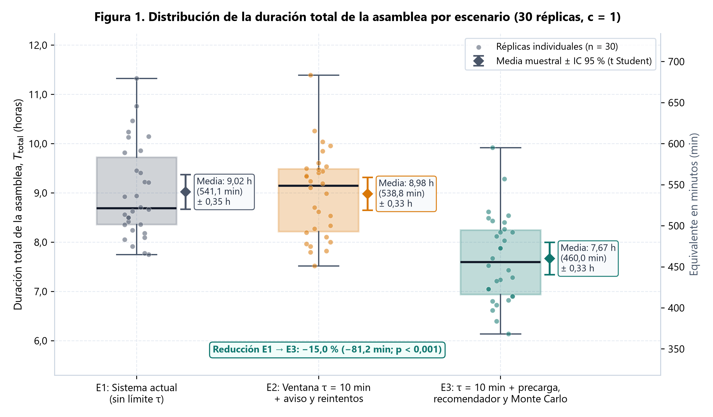
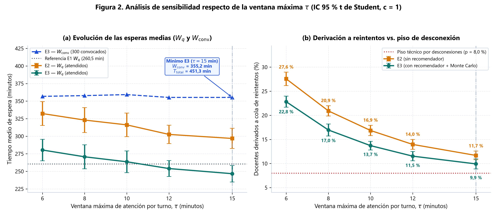
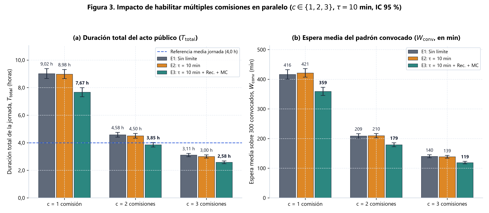
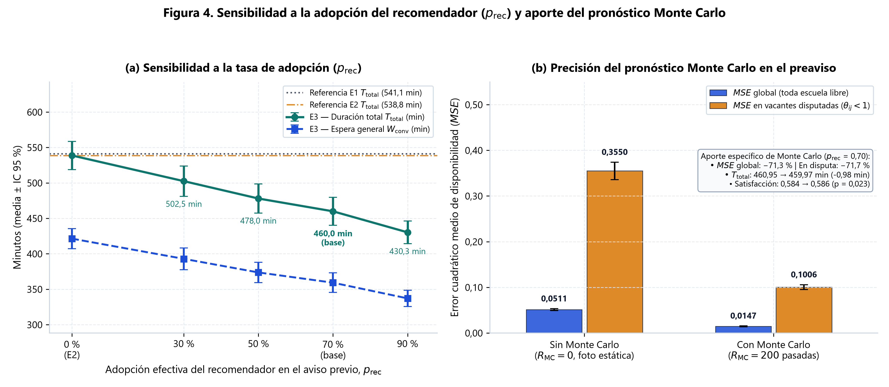

# Universidad Católica de Salta
## Facultad de Ingeniería

---

# Sistema de turnos dinámicos con recomendación de vacantes para las asambleas de designación docente en Salta

**Trabajo Final Integrador — Modalidad A (Aplicación Práctica)**

* **Carrera:** Ingeniería en Informática
* **Asignatura:** Investigación Operativa II
* **Profesor Titular:** Mg. Ing. Gustavo Ramiro Rivadera
* **Profesor Auxiliar:** Ing. Gustavo Flores Vargas
* **Integrantes:**
  * Emiliano Javier Aguirre — DNI 45.770.631
  * Pablo Celaya — DNI 45.115.839
* **Año:** 2026

---

## ÍNDICE

1. [Resumen](#resumen)
2. [1. Introducción](#1-introducción)
   * 1.1. Contexto: el sistema educativo y las designaciones docentes en Salta
   * 1.2. Planteamiento del problema
   * 1.3. Objetivos
   * 1.4. Alcance y limitaciones
   * 1.5. Organización del informe
3. [2. Marco teórico](#2-marco-teórico)
   * 2.1. Elementos de un sistema de colas y Ley de Little
   * 2.2. Modelos analíticos clásicos ($M/M/1$ y $M/M/c$) para validación
   * 2.3. Por qué no alcanzan las fórmulas analíticas en la asignación docente
   * 2.4. Simulación de eventos discretos y prioridades de atención
   * 2.5. Recomendación multicriterio y pronóstico por simulación Monte Carlo
4. [3. Metodología y formulación del modelo](#3-metodología-y-formulación-del-modelo)
   * 3.1. Correspondencia con los elementos de una cola
   * 3.2. Escenario 1 (E1): procedimiento actual sin límite de tiempo
   * 3.3. Escenario 2 (E2): ventana de tiempo $\tau$, aviso previo y cola de reintentos
   * 3.4. Estimador dinámico de horario y notificación previa
   * 3.5. Escenario 3 (E3): recomendación de escuelas y pronóstico de vacantes
   * 3.6. Métricas de desempeño
   * 3.7. Resumen de variables y parámetros
5. [4. Datos e implementación computacional](#4-datos-e-implementación-computacional)
   * 4.1. Origen de los datos: fuentes públicas y datos sintéticos
   * 4.2. Estructura de los archivos CSV
   * 4.3. Uso de la distribución log-normal para los tiempos de elección
   * 4.4. Organización modular del código en Python
6. [5. Verificación, validación y diseño experimental](#5-verificación-validación-y-diseño-experimental)
   * 5.1. Verificación del simulador contra modelos $M/M/1$ y $M/M/c$
   * 5.2. Prueba del recomendador y evaluación del pronóstico
   * 5.3. Diseño de experimentos y análisis de sensibilidad
   * 5.4. Contrastación con referencias operativas reales
7. [6. Resultados y análisis](#6-resultados-y-análisis)
   * 6.1. Resultados de la verificación del simulador ($M/M/1$ y $M/M/c$)
   * 6.2. Desempeño del recomendador y del pronóstico Monte Carlo
   * 6.3. Comparación principal entre escenarios (E1, E2 y E3 — 30 réplicas)
   * 6.4. Gráficos y análisis de sensibilidad
8. [7. Discusión](#7-discusión)
9. [8. Conclusiones](#8-conclusiones)
10. [9. Referencias bibliográficas](#9-referencias-bibliográficas)

---

## RESUMEN

En la Provincia de Salta, la cobertura de cargos docentes interinos y suplentes coordinada junto a la Junta Calificadora de Méritos y Disciplina se realiza mediante actos públicos secuenciales ordenados por el puntaje del Cuadro de Orden de Mérito. En esta modalidad, cada docente que está eligiendo detiene el avance de todos los que vienen detrás mientras revisa qué vacantes quedan libres y toma una decisión. Esto provoca jornadas muy extensas, largas horas de espera sin horario estimado y demoras acumuladas ante indecisiones o cortes de conexión. En este trabajo se modela y evalúa mediante simulación de eventos discretos en Python una propuesta de gestión de turnos sobre un caso representativo del Departamento Capital (300 docentes, 100 cargos vacantes y 40 escuelas públicas). Se comparan tres escenarios principales: el Escenario 1 (E1) representa el llamado secuencial actual sin tiempo límite; el Escenario 2 (E2) incorpora un tiempo máximo de elección por turno ($\tau = 10$ minutos), un estimador de horario que avisa 10 minutos antes y una cola secundaria de reintentos; y el Escenario 3 (E3) suma una carga previa de preferencias, un recomendador sencillo basado en cercanía, turno y coincidencias entre colegas, y un pronóstico rápido por simulación Monte Carlo que anticipa qué escuelas tienen mayor probabilidad de llegar libres al turno del docente. El motor de simulación se verifica contra las fórmulas teóricas de los modelos $M/M/1$ y $M/M/c$ vistos en la asignatura, y se analizan distintos valores de ventana $\tau$, cantidad de mesas de atención simultáneas y niveles de aceptación del recomendador. Los resultados sobre 30 réplicas independientes muestran que limitar el reloj sin orientar al docente (E2) prácticamente no acorta la jornada respecto de E1 ($538,79$ vs. $541,14\text{ min}$; $-0,4\,\%$) y aumenta un 21,4 % la espera acumulada de los atendidos por la doble espera en reintentos; en cambio, el sistema asistido (E3) reduce un **15,0 %** la duración total de la asamblea (de $9,02\text{ h}$ a $7,67\text{ h}$, ahorrando $81,2\text{ min}$), disminuye un **13,7 %** la espera media de los 300 convocados y un **10,7 %** la espera hasta el primer llamado, y recorta un **20,6 %** la cantidad de docentes desplazados en su mérito al pasar a reintento.

**Palabras clave:** teoría de colas, simulación de eventos discretos, turnos dinámicos, sistemas de recomendación, pronóstico Monte Carlo, designaciones docentes.

---

## 1. INTRODUCCIÓN

### 1.1. Contexto: el sistema educativo y las designaciones docentes en Salta

El sistema educativo de la Provincia de Salta cuenta con más de 2.300 unidades educativas de gestión estatal y privada y supera los 450.000 alumnos matriculados en todos sus niveles y modalidades, de los cuales más de 350.000 asisten a los niveles obligatorios Inicial, Primario y Secundario (Ministerio de Educación, Cultura, Ciencia y Tecnología de Salta [MECCyT], 2024a). Según el Censo Nacional de Población, Hogares y Viviendas 2022, la provincia tiene 1.441.351 habitantes y el Departamento Capital concentra 627.704 habitantes —el 43,5 % del total provincial— en una superficie de 1.722 km² (Instituto Nacional de Estadística y Censos [INDEC], 2023). Debido a esta concentración demográfica, los actos públicos de designación docente en Salta Capital convocan a cientos de postulantes en una misma jornada, especialmente al inicio del ciclo lectivo entre febrero y marzo.

Desde el punto de vista legal, el ingreso a la docencia y la cobertura de interinatos y suplencias están regulados por la Ley Provincial N.° 6.830 (*Estatuto del Educador*, junto con sus modificatorias Leyes N.° 7.189 y N.° 8.325). Sus artículos 10 y 12 establecen que la Junta Calificadora de Méritos y Disciplina —dividida en salas para Nivel Inicial y Primario y para Nivel Secundario, con sede central en calle Caseros 975 de la ciudad de Salta— es el organismo encargado de evaluar los antecedentes de los docentes y confeccionar los padrones por estricto orden de mérito (Gobierno de la Provincia de Salta, 1995). El puntaje de cada postulante se calcula todos los años aplicando la Resolución Ministerial N.° 1.851/08, que valora título, antigüedad, capacitaciones, concepto profesional y residencia para publicar los cuadros provisorios, abrir el período de reclamos (*tachas*) y emitir las *tirillas* definitivas de puntaje en el portal oficial *Edusalta* (Ministerio de Educación de la Provincia de Salta, 2008).

Una vez publicados los cuadros definitivos, la asignación de los cargos vacantes en las escuelas se lleva a cabo en actos públicos organizados por la Secretaría de Gestión Educativa y las Direcciones de Nivel, tanto en forma presencial (en escuelas cabecera o sedes ministeriales) como en modalidades virtuales incorporadas desde la pandemia. Más allá del formato, la regla central es siempre la misma: se llama a los docentes de mayor a menor puntaje y cada uno elige un cargo compatible entre las vacantes que siguen libres en ese momento.

### 1.2. Planteamiento del problema

Aunque llamar uno por uno según el puntaje asegura transparencia y respeta la normativa vigente, en la práctica esta forma de trabajo genera cuatro cuellos de botella claros, típicos de una fila con un único canal de atención sin límite de tiempo:

1. **Efecto tapón o bloqueo secuencial (*head-of-line blocking*).** Como el llamado es estrictamente uno tras otro, el docente ubicado en la posición $k + 1$ no puede empezar a elegir hasta que termine el docente en la posición $k$. Una sola persona indecisa demora a todos los que están detrás en la fila.
2. **Aumento del tiempo de decisión a medida que avanza el acto.** Los primeros docentes del listado casi siempre encuentran libre la escuela que buscaban y resuelven su turno en un par de minutos. En cambio, a medida que las escuelas céntricas o de turnos más pedidos se van ocupando, muchos docentes de mitad de tabla en adelante llegan a su turno y recién ahí se enteran de que ninguna de las opciones que tenían pensadas sigue disponible. En ese instante deben ponerse a revisar toda la planilla de vacantes restantes —mirando barrios, distancias, líneas de colectivo y horarios—, lo que multiplica el tiempo que tardan frente a la mesa. Dado que el Ministerio no publica registros cronometrados de la duración individual de cada atención en mesa, este incremento del tiempo de elección se modela de manera sintética bajo supuestos explícitos (sección 4.3), en línea con los cuellos de botella administrativos y demoras en sedes de designación reportados en convocatorias masivas de la provincia (Gobierno de la Provincia de Salta, 2025; Navarro, 2023).
3. **Espera a ciegas e incertidumbre de horario.** Al no contar con un cálculo dinámico de a qué hora aproximada les va a tocar, los docentes deben permanecer en el salón o pendientes de la pantalla durante horas sin saber si serán llamados en quince minutos o cuatro horas después. De hecho, los cronogramas oficiales publicados en *Edusalta* citan a los postulantes desde primera hora de la mañana (por ejemplo, a las 8:00 hs) bajo la modalidad abierta *«hasta lo que dure la jornada»* o *«hasta que finalice la jornada»* (MECCyT, 2024b), registrándose reclamos en Salta Capital por esperas de varias horas afuera de las oficinas de designación sin certeza de atención (Navarro, 2023).
4. **Tiempos muertos por ausencias o cortes de internet.** En instancias virtuales o mixtas, cuando alguien no responde o sufre una caída de conexión, la mesa debe repetir los llamados reglamentarios de verificación antes de seguir con el próximo postulante, acumulando minutos muertos o reclamos si el corte fue involuntario.

El problema abordado en este proyecto consiste en diseñar, modelar matemáticamente y evaluar por simulación un sistema de turnos dinámicos que reduzca el tiempo de espera en fila y la duración total de la asamblea, respetando el orden de mérito de la lista principal y midiendo de forma transparente qué ocurre con los docentes que pasan a una instancia de reintento.

Desde la formulación de Investigación Operativa, las **decisiones que se desean estudiar** comprenden la fijación del tiempo máximo por turno ($\tau$), el dimensionamiento de comisiones simultáneas ($c$) y el efecto de asistir al postulante con precarga, recomendación y pronóstico previo; sujetas a las **restricciones** normativas y operativas de respetar estrictamente el orden decreciente de puntaje $P_i$ en la cola principal (Ley N.° 6.830), exigir compatibilidad de nivel y especialidad para cada cargo y no superar el cupo finito de $V_{\text{tot}} = 100$ vacantes ofrecidas.

### 1.3. Objetivos

#### 1.3.1. Objetivo general

Formular, implementar en Python y evaluar mediante simulación de eventos discretos un sistema de turnos dinámicos con tiempo máximo de atención, cola de reintentos y recomendación anticipada de vacantes, con el fin de reducir los tiempos de espera y la duración total de las asambleas de designación docente en Salta Capital respetando el orden de mérito vigente.

#### 1.3.2. Objetivos específicos

1. Modelar el acto público de designación docente desde el enfoque de la Teoría de Colas, identificando las características reales del proceso (cantidad finita de docentes, jornada con inicio y cierre, prioridad por puntaje, tope de tiempo por turno y cola de reintentos) que hacen necesario recurrir a la simulación computacional.
2. Verificar el correcto funcionamiento del motor de simulación de eventos discretos comparando sus resultados en régimen estacionario contra las fórmulas exactas de los modelos $M/M/1$ y $M/M/c$ desarrollados en la cátedra.
3. Diseñar un módulo de precarga de preferencias, recomendación multicriterio de escuelas alternativas y pronóstico rápido de vacantes mediante simulación Monte Carlo, orientado a reducir el tiempo de búsqueda del docente cuando sus opciones iniciales ya fueron tomadas.
4. Comparar estadísticamente tres escenarios operativos —sistema actual (E1), sistema digital con ventana de tiempo y reintentos (E2), y sistema asistido con recomendador y pronóstico (E3)— realizando además análisis de sensibilidad sobre el tiempo máximo por turno ($\tau$), la cantidad de mesas simultáneas ($c$) y el grado de adopción de las recomendaciones.
5. Elaborar propuestas prácticas y viables para la gestión de los actos públicos de designación a partir de los resultados obtenidos, contemplando aspectos normativos y de conectividad.

### 1.4. Alcance y limitaciones

El trabajo comprende la formulación del modelo matemático y de simulación, el armado de un conjunto de datos basado en escuelas públicas reales de Salta Capital combinado con datos sintéticos reproducibles de docentes y vacantes, la programación completa en Python, la verificación contra modelos teóricos y la comparación estadística de escenarios.

Quedan fuera del alcance de este estudio:
* El desarrollo de una plataforma web o aplicación móvil final para usuarios (pantallas, login, servidores en la nube o envío real de mensajes por WhatsApp/SMS).
* El proceso administrativo previo de inscripción anual, valoración de carpetas y resolución de reclamos de puntaje, tomando como punto de partida el Cuadro de Orden de Mérito definitivo ya publicado.
* Las designaciones por bloques fraccionados de horas cátedra propias del Nivel Secundario, enfocándose el modelo en cargos completos e indivisibles (como Maestro de Grado o Nivel Inicial), donde cada docente toma a lo sumo un cargo.

### 1.5. Organización del informe

En la sección 2 se repasan los conceptos teóricos de colas, simulación y pronóstico utilizados en el proyecto. La sección 3 explica paso a paso el modelo matemático de los tres escenarios, el estimador de horarios, el recomendador y las métricas de evaluación. La sección 4 describe cómo se armaron los archivos de datos de Salta Capital y cómo está estructurado el código en Python. La sección 5 detalla las pruebas de verificación del simulador y los experimentos planteados. Finalmente, las secciones 6, 7 y 8 presentan los resultados con sus gráficos, la discusión práctica y las conclusiones del trabajo.

---

## 2. MARCO TEÓRICO

### 2.1. Elementos de un sistema de colas y Ley de Little

Un sistema de colas está compuesto por clientes que llegan buscando un servicio, uno o más servidores encargados de atenderlos y una fila o cola donde los clientes aguardan cuando todos los servidores están ocupados, ordenados según una regla o disciplina de atención (Hillier y Lieberman, 2015, cap. 17; Rivadera, 2026a).

Para resumir las características de una cola se utiliza la notación de Kendall $(A/B/c):(D/E/F)$, donde $A$ indica la distribución del tiempo entre llegadas, $B$ la distribución del tiempo de servicio, $c$ la cantidad de servidores en paralelo, $D$ la disciplina de atención (por ejemplo, orden de llegada FIFO o prioridad), $E$ la capacidad máxima del sistema y $F$ el tamaño de la población de origen. Si los clientes llegan a una tasa media $\lambda$ (clientes por unidad de tiempo) y cada servidor puede atender a una tasa media $\mu$, el factor de utilización de los servidores es:

$$\rho = \frac{\lambda}{c \mu}$$

Cuando el sistema es estable ($\rho < 1$), su desempeño se resume en cuatro medidas principales: la cantidad media de clientes en todo el sistema ($L$), la cantidad media esperando en la cola ($L_q$), el tiempo medio total en el sistema ($W$) y el tiempo medio de espera en la cola ($W_q$). Estas métricas están relacionadas por la **Ley de Little** (Little, 1961):

$$L = \lambda W \quad ; \quad L_q = \lambda W_q$$

$$W = W_q + \frac{1}{\mu} \quad ; \quad L = L_q + \frac{\lambda}{\mu}$$

En un proceso que dura una jornada finita de longitud $T_{\text{total}}$ con $N$ personas convocadas desde el inicio, la relación entre el largo medio de la fila y los tiempos individuales de espera se cumple de forma exacta como promedio en el tiempo. Si $N_{\text{cola}}(t)$ es la cantidad de docentes esperando en el minuto $t$ y $Q_i$ es el tiempo total que el docente $i$ pasó esperando en fila durante el acto, el área bajo la curva de espera cumple:

$$L_q = \frac{1}{T_{\text{total}}} \int_0^{T_{\text{total}}} N_{\text{cola}}(t)\,dt = \frac{1}{T_{\text{total}}} \sum_{i=1}^{N} Q_i$$

Esta igualdad resulta muy útil en programación porque permite controlar automáticamente en cada corrida del simulador que los tiempos de espera individuales y la longitud promedio de la cola estén bien calculados.

### 2.2. Modelos analíticos clásicos ($M/M/1$ y $M/M/c$) para validación

Los modelos básicos estudiados en la materia suponen llegadas según un proceso de Poisson (tiempos entre arribos exponenciales de media $1/\lambda$) y tiempos de atención también exponenciales e independientes de media $1/\mu$.

Aunque estos modelos no describen directamente una asamblea docente (por los motivos que se explican en 2.3), sus fórmulas exactas sirven como **caso de prueba obligatorio** para comprobar que nuestro código de simulación maneja bien el reloj, los eventos y las colas antes de cargarle las reglas reales del problema (Rivadera, 2026b, 2026c):

1. **Modelo $M/M/1$ (un solo servidor, cola y población infinitas):**
   $$L = \frac{\rho}{1 - \rho} \quad ; \quad L_q = \frac{\rho^2}{1 - \rho} \quad ; \quad W = \frac{1}{\mu - \lambda} \quad ; \quad W_q = \frac{\rho}{\mu - \lambda}$$
   Por ejemplo, con $\lambda = 4$ clientes/hora y $\mu = 6$ clientes/hora ($\rho = 2/3 \approx 0,6667$), las fórmulas dan exactamente $L_q = 1,3333$ clientes en fila y $W_q = 0,3333$ horas (20 minutos).

2. **Modelo $M/M/c$ (varios servidores idénticos en paralelo):**
   Con $c$ servidores y utilización $\rho = \lambda / (c\mu) < 1$, la probabilidad de que el sistema esté vacío ($P_0$) y la longitud media de la cola ($L_q$) se calculan mediante las expresiones de Erlang-C:
   $$P_0 = \left[ \sum_{n=0}^{c-1} \frac{(\lambda/\mu)^n}{n!} + \frac{(\lambda/\mu)^c}{c!} \cdot \frac{1}{1 - \rho} \right]^{-1}$$
   $$L_q = \frac{P_0 (\lambda/\mu)^c \rho}{c! (1 - \rho)^2} \quad ; \quad W_q = \frac{L_q}{\lambda}$$
   Por ejemplo, para $\lambda = 2$ y $\mu = 3$ clientes/hora, con un único servidor ($c = 1$) la espera media es $W_q = 0,6667$ horas (40 minutos), mientras que al habilitar un segundo servidor ($c = 2$) la espera cae drásticamente a $W_q = 0,0417$ horas (2,5 minutos). Esto muestra cómo agregar capacidad reduce la congestión de manera no lineal.

### 2.3. Por qué no alcanzan las fórmulas analíticas en la asignación docente

Las fórmulas cerradas de $M/M/1$ y $M/M/c$ no se pueden aplicar directamente para calcular las esperas de una asamblea docente porque la operatoria real rompe varios de sus supuestos básicos:

* **Jornada finita en lugar de estado estacionario:** las ecuaciones teóricas calculan promedios cuando el tiempo tiende a infinito ($t \to \infty$). Una asamblea empieza a una hora puntual con un listado cerrado y termina apenas se cubren los cargos o se llama al último docente.
* **Población finita presente desde el inicio:** los $N = 300$ docentes no van llegando al azar durante el día como en un banco o un supermercado; ya están anotados y habilitados desde el minuto cero.
* **Tiempos de decisión no exponenciales y con corte por reloj:** lo que tarda una persona en elegir escuela no sigue una distribución exponencial; la mayoría resuelve en pocos minutos y unos pocos demoran bastante más (comportamiento asimétrico que representamos con una distribución log-normal). Además, al poner un límite de $\tau = 10$ minutos, el servicio se corta en $S = \min(T_{\text{elección}}, \tau)$.
* **Atención por orden de mérito y cola de reintentos:** el llamado sigue el puntaje de cada docente y quienes superan el tiempo máximo vuelven a esperar en una cola secundaria.
* **Vacantes que se agotan turno a turno:** cada cargo tomado achica las opciones disponibles para quienes siguen atrás, haciendo que los tiempos de elección cambien a lo largo de la jornada.

Frente a todas estas condiciones combinadas, la herramienta adecuada dentro de la Investigación Operativa es la **simulación de eventos discretos** (Law, 2015; Taha, 2017).

### 2.4. Simulación de eventos discretos y prioridades de atención

En una **simulación de eventos discretos (SED)** el estado del sistema (cuántas personas esperan, qué mesas están ocupadas y qué vacantes quedan libres) solo cambia en instantes puntuales llamados *eventos*: el inicio de un turno, la confirmación de un cargo o el vencimiento del tiempo límite (Banks et al., 2010; Law, 2015). Para no perder tiempo simulando segundo por segundo, el programa mantiene una **lista de eventos futuros (FEL)** ordenada por hora de ocurrencia mediante una cola de prioridad (`heapq` en Python) y hace saltar el reloj directamente al evento más próximo.

En cuanto al orden de llamado, las asambleas docentes funcionan como una cola con **prioridad no apropiativa**: los postulantes se ordenan de mayor a menor puntaje de mérito $P_i$, pero una vez que un docente empezó su turno nadie puede interrumpirlo hasta que elija o se cumpla su tiempo máximo $\tau$ (Hillier y Lieberman, 2015). Si el tiempo $\tau$ vence sin elección, el postulante pasa a una **cola secundaria de reintentos**, la cual recién se atiende cuando termina de pasar la cola principal para no demorar a quienes todavía no tuvieron su primer turno.

Por tratarse de un sistema con inicio y cierre fijo, no corresponde descartar un período de calentamiento (*warm-up*). Además, como la demora de un docente afecta directamente a todos los que están detrás en esa misma jornada, los turnos de un mismo día no son independientes entre sí. Por eso, para obtener resultados estadísticamente confiables se ejecutan **$R_{\text{rep}} = 30$ réplicas completas e independientes** (cambiando la semilla aleatoria en cada corrida) y se calcula para cada indicador su media muestral $\bar{X}$ junto con su intervalo de confianza del 95 % usando la distribución $t$ de Student:

$$\bar{X} \pm t_{R_{\text{rep}} - 1 \, ; \, 0,975} \cdot \frac{s}{\sqrt{R_{\text{rep}}}}$$

### 2.5. Recomendación multicriterio y pronóstico por simulación Monte Carlo

Como la Ley Provincial N.° 6.830 exige respetar el orden de mérito y la libre elección del docente en su turno, no sería válido legalmente reemplazar el acto público por un algoritmo que asigne escuelas de manera forzosa ni alterar el orden del listado. La mejora pasa, en cambio, por **ayudar al docente a llegar preparado a su turno** cuando las escuelas que quería originalmente están por agotarse.

Para lograrlo combinamos dos herramientas simples y complementarias:
1. **Sistema de recomendación híbrido sencillo** (Ricci, Rokach y Shapira, 2015): primero filtra únicamente las escuelas con vacantes compatibles que cumplan las condiciones básicas del docente (distancia máxima desde su casa, turnos en los que puede trabajar y si acepta zona rural), y luego las ordena combinando tres puntajes fáciles de interpretar: cercanía en kilómetros, parecido con las escuelas que el docente había preseleccionado y frecuencia con que otros docentes de gustos similares eligieron esa misma escuela.
2. **Pronóstico rápido mediante simulación Monte Carlo**: diez minutos antes del turno estimado de un docente quedan pocos postulantes delante de él. En ese momento el programa simula rápidamente 200 veces las elecciones de esos pocos docentes previos para estimar qué probabilidad tiene cada escuela de seguir libre cuando le toque elegir, evitando sugerir vacantes que casi seguro se van a ocupar un par de turnos antes.

---

## 3. METODOLOGÍA Y FORMULACIÓN DEL MODELO

### 3.1. Correspondencia con los elementos de una cola

La asamblea de designación se traduce a los componentes de un sistema de colas según la siguiente tabla:

| Elemento del sistema de colas | Equivalente en la asamblea de designación docente |
| :--- | :--- |
| **Cliente** | Docente incluido en el Cuadro de Orden de Mérito definitivo |
| **Población de entrada** | Finita y cerrada: $N = 300$ docentes habilitados desde la apertura del acto |
| **Servidor** | Comisión o mesa de designación ($c = 1$ en el caso base; $c \in \{2, 3\}$ en sensibilidad) |
| **Tiempo de servicio** | Duración efectiva del turno del docente (según tiempo de elección, límite $\tau$ o verificación de ausencia) |
| **Colas de espera** | Cola principal ordenada por puntaje $P_i$ y (en E2 y E3) cola secundaria de reintentos |
| **Disciplina de atención** | Prioridad no apropiativa de mayor a menor puntaje $P_i$; la cola principal tiene prioridad sobre la de reintentos |
| **Capacidad** | Finita, limitada a los $N = 300$ docentes convocados |
| **Fallas / ausencias** | Probabilidad $p = 0,08$ de no responder o desconectarse al ser llamado, con $T_{\text{aus}} = 5$ min de verificación |

Además de las filas, el sistema trabaja sobre un **listado compartido de $V_{\text{tot}} = 100$ vacantes**: el acto termina apenas se adjudica el último cargo disponible o cuando ya no quedan docentes por atender en ninguna de las colas.

**Caso de docentes sin vacantes compatibles (*sin oferta*).** Al haber 300 docentes para 100 cargos divididos por nivel y especialidad, llega un punto de la jornada en que para ciertas especialidades ya no queda ningún cargo libre en ninguna escuela. Cuando se llama a un docente en esa situación, tanto en E1 como en E2 y E3 se registra un trámite rápido de constancia de $t_{\text{pase}} = 0,5$ minutos, el docente se retira como *sin oferta* y no se lo envía a la cola de reintentos.

### 3.2. Escenario 1 (E1): procedimiento actual sin límite de tiempo

El Escenario 1 representa el acto público tradicional con una única comisión ($c = 1$) y sin reloj máximo por turno. Se llama a los postulantes por orden decreciente de puntaje $P_i$ y cada docente utiliza todo el tiempo que necesita para revisar la planilla y decidir:

$$S_j = T_{\text{elección}, j}$$

Si el docente llamado está ausente o tiene un problema de conexión (probabilidad $p = 0,08$), la mesa realiza los llamados de rigor durante un tiempo fijo $T_{\text{aus}} = 5$ minutos y, al no obtener respuesta, pasa al siguiente en la lista perdiendo aquel su turno (en E1 no hay cola de reintentos).

En este esquema el docente en la posición $k$ acumula como espera la suma completa de los turnos anteriores: $W_{q, k} = \sum_{j=1}^{k-1} S_j$. Cuando las escuelas más buscadas se agotan, el tiempo promedio de búsqueda de los docentes sube de unos 2 minutos a unos 8 minutos (con casos puntuales de 15 o 20 minutos por la asimetría de la distribución log-normal), trasladando toda esa demora al resto de la fila.

### 3.3. Escenario 2 (E2): ventana de tiempo $\tau$, aviso previo y cola de reintentos

El Escenario 2 digitaliza el manejo del turno agregando un tiempo límite de **$\tau = 10$ minutos** por atención, de manera que la duración máxima en ventanilla queda acotada por:

$$S = \min(T_{\text{elección}}, \tau)$$

Si el docente confirma su escuela dentro de los 10 minutos ($T_{\text{elección}} \le \tau$), se le asigna el cargo, se descuenta la vacante y finaliza su trámite. Si en cambio pasan los 10 minutos sin que haya podido decidirse ($T_{\text{elección}} > \tau$), o si sufre una desconexión al ser llamado, el sistema libera la atención para no frenar al resto y pasa a ese docente a una **cola secundaria de reintentos**.

Para que el comportamiento del modelo sea claro y parejo, se fijan cinco reglas sencillas:
1. **Desconexiones o ausencias:** se esperan los mismos $T_{\text{aus}} = 5$ minutos de verificación que en E1, pero en lugar de quedar eliminado del acto, el docente pasa a la cola de reintentos.
2. **Cuándo se atiende la cola de reintentos:** recién cuando termina de pasar el último docente de la cola principal (siempre que todavía queden vacantes sin cubrir).
3. **Orden dentro de reintentos:** se mantiene el orden de mérito original de mayor a menor puntaje $P_i$.
4. **Máximo un reintento:** cada docente tiene a lo sumo una segunda oportunidad. Al volver a ser llamado se sortea un nuevo tiempo de decisión según las vacantes libres en ese momento; si vuelve a superar $\tau$ o sigue desconectado, queda fuera sin asignación.
5. **Sin vacantes compatibles:** si al llegar su reintento ya se agotaron todos los cargos de su especialidad, egresa en $t_{\text{pase}} = 0,5$ min bajo la condición *sin oferta*.

Evaluando la distribución log-normal ($\sigma = 0,8$) para $\tau = 10$ minutos y $p = 0,08$, se observa claramente por qué la ventana actúa como un filtro sobre las demoras largas sin perjudicar a quien ya sabe qué elegir:

| Situación del docente | Tiempo medio sin tope | Probabilidad de superar 10 min | Pasan a reintento (incluyendo 8 % de fallas de red) | Tiempo medio efectivo en mesa |
| :--- | :---: | :---: | :---: | :---: |
| Docente con escuela prevista libre (Caso A) | 2,0 min | 0,8 % | 8,7 % | 2,21 min |
| Docente revisando planilla desde cero (Caso C) | 8,0 min | 24,9 % | 30,9 % | 6,01 min |

Como muestra la tabla, a un docente que tiene disponible alguna de sus escuelas buscadas casi nunca se le corta el turno por reloj (menos del 1 % de las veces). En cambio, cuando alguien llega sin opciones conocidas y empieza a revisar toda la planilla en vivo, casi 1 de cada 4 veces supera los 10 minutos.

**Limitación de digitalizar sin orientar al docente (efecto en el orden de mérito).** Si bien mandar a los indecisos a la cola de reintentos destraba la fila principal, tiene una contracara importante: como hay 300 docentes para 100 cargos, mientras la fila principal sigue avanzando las vacantes se van terminando. Cuando finalmente toca atender la cola de reintentos, es muy probable que varios docentes con puntaje alto que habían sido derivados ya no encuentren vacantes de su especialidad porque las tomaron docentes con menor puntaje que venían detrás. Medimos explícitamente este problema mediante el indicador de *casos afectados en su mérito por reintento* (sección 3.6), que muestra por qué limitar el reloj por sí solo no alcanza y motiva las herramientas del Escenario 3.

### 3.4. Estimador dinámico de horario y notificación previa

Como el orden del listado se conoce desde que arranca el acto, en cualquier minuto $t_{\text{actual}}$ el sistema puede calcular a qué hora aproximada será atendido el docente que ocupa el lugar $k$ de la fila pendiente sumando la duración esperada de quienes están antes:

$$E[T_k] = t_{\text{actual}} + \frac{1}{c} \cdot \left( \sum_{m=1}^{c_{\text{ocup}}} E[S_{\text{restante}, m}] + \sum_{j=1}^{k-1} E[S_j] \right)$$

Como el sistema real no conoce de antemano cuánto tarda en decidir cada persona (y en E2 tampoco cuenta con listas precargadas), el tiempo esperado de atención se estima dinámicamente mediante **suavización exponencial simple** a partir de las duraciones reales observadas en la asamblea. Cada vez que finaliza el turno efectivo $S_{\text{obs}}$ de un docente que tenía oferta disponible, se actualiza el promedio suavizado $\hat{S}$ con factor $\alpha = 0,20$ (partiendo de $\hat{S}_0 = 3,0$ minutos):

$$\hat{S}_{\text{nuevo}} = \alpha \cdot S_{\text{obs}} + (1 - \alpha) \cdot \hat{S}_{\text{anterior}}$$

Con este valor actualizado:
* Para cada docente $j$ que aguarda adelante en la fila, se estima $E[S_j] = \hat{S}$ si todavía quedan vacantes libres de su nivel y especialidad, o bien $E[S_j] = t_{\text{pase}} = 0,5$ minutos si los cargos compatibles ya se agotaron.
* Para cada mesa ocupada $m$ que lleva $t_{\text{trans}, m}$ minutos de atención en curso, el tiempo remanente esperado se acota como $E[S_{\text{restante}, m}] = \max(0,\, \hat{S} - t_{\text{trans}, m})$.

Este pronóstico de horario se recalcula al finalizar cada turno. La primera vez que para un docente en espera (no atendido en el instante inicial $t = 0$) se cumple que:

$$E[T_k] - t_{\text{actual}} \le 10 \text{ minutos}$$

el sistema le envía un único aviso automático (*«Prepárese: su turno estimado es en 10 minutos»*) y registra esa hora prometida $E[T_k]_{\text{avisado}}$ para evaluar luego su precisión mediante el $MAE$.

### 3.5. Escenario 3 (E3): recomendación de escuelas y pronóstico de vacantes

Mientras que E2 frena los atrasos cortando el turno a los 10 minutos, el Escenario 3 busca evitar que el docente llegue desorientado a la ventanilla. Manteniendo exactamente las mismas reglas de cola y ventana $\tau = 10$ minutos de E2, el E3 agrega una **precarga simple antes del acto público** y un **aviso enriquecido 10 minutos antes del turno** con sugerencias personalizadas y probabilidades de vacante.

#### 3.5.1. Precarga y filtro de condiciones básicas

Antes de que comience la asamblea, cada docente $i$ carga en el sistema una lista ordenada $L_i$ con hasta $M = 5$ escuelas de su preferencia y completa tres filtros básicos sobre qué alternativas estaría dispuesto a aceptar si sus cinco opciones se agotan:

* **$R_i$**: distancia máxima en línea recta desde su domicilio hasta la escuela (en km).
* **$\text{Turnos}_i$**: turnos en los que puede trabajar (`mañana`, `tarde`, `noche`).
* **$\text{Rural}_i$**: indica con `1` si acepta escuelas rurales o `0` si solo busca escuelas urbanas.

Al momento de buscarle alternativas al docente $i$, el sistema arma el conjunto $K_i$ únicamente con aquellas escuelas que tienen al menos una vacante libre compatible con su título/nivel y que cumplen al mismo tiempo la distancia $d_{ij} \le R_i$, el turno y el tipo urbano/rural elegido. Nunca se le recomienda una escuela fuera de sus propios límites.

#### 3.5.2. Puntaje multicriterio para ordenar alternativas

Para puntuar qué tan conveniente es cada escuela candidata $j \in K_i$ (que no estaba en su lista inicial $L_i$), se calcula un promedio ponderado entre 0 y 1:

$$\text{Puntaje}_{ij} = w_d \cdot D_{ij} + w_t \cdot T_{ij} + w_c \cdot C_{ij} \quad \text{con } w_d + w_t + w_c = 1$$

Los tres criterios reflejan aspectos prácticos que cualquier docente mira al elegir:

1. **Cercanía al domicilio ($D_{ij}$):**
   $$D_{ij} = 1 - \frac{d_{ij}}{R_i}$$
   Vale 1 si la escuela está pegada a su domicilio y baja linealmente hasta 0 en el límite de distancia $R_i$ que el docente indicó como máximo tolerable.
2. **Parecido con sus escuelas elegidas ($T_{ij}$):** compara los atributos de la escuela candidata $j$ contra cada escuela $s$ de la lista precargada $L_i$, promediando la coincidencia de zona barrial, ámbito urbano/rural (`escuelas.csv`) y disponibilidad de algún turno compatible en común dentro de la oferta vigente (`cargos.csv`):
   $$T_{ij} = \frac{1}{|L_i|} \sum_{s \in L_i} \frac{I(\text{zona}_j = \text{zona}_s) + I(\text{tipo}_j = \text{tipo}_s) + I(\text{TurnosLibres}_j \cap \text{Turnos}_s \ne \emptyset)}{3}$$
   donde $\text{TurnosLibres}_j$ son los turnos con vacante compatible abierta en la escuela $j$ y $\text{Turnos}_s$ los turnos ofrecidos originalmente en la escuela $s$.
3. **Elecciones de docentes con gustos parecidos ($C_{ij}$):** se fija qué tan elegida fue esa escuela $j$ en las listas de otros docentes que también anotaron escuelas en común con el docente $i$:
   $$C_{ij} = \frac{\sum_{k \ne i} |L_k \cap L_i| \cdot I(j \in L_k)}{\sum_{k \ne i} |L_k \cap L_i|}$$
   donde $|L_k \cap L_i|$ es la cantidad de escuelas en común entre las listas de ambos docentes, e $I(j \in L_k)$ vale 1 si el colega $k$ incluyó a la escuela $j$ y 0 si no la incluyó (si el denominador resulta igual a 0, se define $C_{ij} = 0$).

Como valores iniciales usamos $w_d = 0,50$, $w_t = 0,20$ y $w_c = 0,30$, los cuales luego se calibran probando combinaciones sobre la grilla en la sección 5.2 (hallándose el óptimo en $w_d = 0,40 ; w_t = 0,40 ; w_c = 0,20$).

#### 3.5.3. Pronóstico de disponibilidad mediante simulación Monte Carlo

Cuando faltan 10 minutos para el turno del docente $i$ (momento en que sale el aviso de preparación), suelen quedar apenas entre 2 y 5 docentes delante de él en la fila. Sin embargo, esos pocos turnos previos pueden llevarse justo la última vacante de las escuelas que a él le interesaban.

Para anticiparse a eso, en el momento de enviar el aviso el programa toma una copia de las vacantes libres en ese instante y corre en segundo plano **$R_{\text{MC}} = 200$ simulaciones rápidas (Monte Carlo)** de esos pocos docentes que están adelante:
1. En cada una de las 200 pasadas, simula turno por turno a los docentes previos a $i$: contempla la probabilidad de que no adjudiquen cargo en ese turno ya sea por desconexión ($p$) o por superar la ventana máxima $\tau = 10$ minutos (sorteando un tiempo log-normal con media poblacional $\bar{m} = 2,0$ min si tienen opciones de su lista $L_h$ libres o $4\bar{m} = 8,0$ min si su lista está agotada), y en caso de concretar elección descuentan la primera escuela libre de $L_h$ (o una alternativa compatible dentro de sus filtros $K_h$ si $L_h$ ya se agotó).
2. Al llegar al turno de $i$, anota qué escuelas conservaron al menos una vacante libre para su especialidad.
3. Dividiendo por 200 la cantidad de veces que la escuela $j$ llegó con lugar libre, se obtiene la **probabilidad estimada de disponibilidad $\theta_{ij} \in [0, 1]$**.

Con ese dato, la notificación de 10 minutos antes le muestra al docente el semáforo de probabilidad $\theta_{ij}$ de sus 5 escuelas preferidas y, debajo, le sugiere las **$k_{\text{rec}} = 3$ mejores escuelas alternativas** ordenadas por el producto $\text{Puntaje}_{ij} \cdot \theta_{ij}$ (es decir, escuelas que se ajustan a su perfil y que además tienen alta chance de seguir libres cuando lo llamen). Así el docente aprovecha esos 10 minutos de espera previa para pensar su decisión tranquilo, en vez de enterarse sobre la marcha en la ventanilla.

#### 3.5.4. Efecto sobre el tiempo de elección y adjudicación de vacante (Casos A, B y C)

Para conectar de manera clara la disponibilidad de vacantes con lo que tarda cada docente $i$ en su turno, partimos de su tiempo medio base $m_i$ (entre 1 y 3 minutos) cuando encuentra libre lo que quería, y definimos tres situaciones posibles al momento de ser atendido:

| Situación | Qué encuentra el docente $i$ al iniciar su turno | Tiempo medio de decisión | Cuándo ocurre en E1 y E2 | Cuándo ocurre en E3 |
| :---: | :--- | :---: | :--- | :--- |
| **Caso A** | Al menos una de las 5 escuelas de su lista $L_i$ sigue con vacante libre | **$1 \cdot m_i$** (~2 min) | Siempre que $L_i$ tenga vacante libre | Siempre que $L_i$ tenga vacante libre |
| **Caso B** | Su lista $L_i$ se agotó, pero al menos una de las 3 escuelas recomendadas en el aviso previo sigue libre y el docente se guía por ellas | **$2 \cdot m_i$** (~4 min) | Nunca (no hay recomendador ni preaviso de vacantes) | Con probabilidad de adopción **$p_{\text{rec}} = 0,70$** si alguna sugerida sigue libre |
| **Caso C** | Su lista $L_i$ se agotó y el docente se pone a revisar toda la planilla restante en el momento | **$4 \cdot m_i$** (~8 min) | Siempre que $L_i$ esté agotada | Con probabilidad $1 - p_{\text{rec}}$ (no usa la sugerencia), o si las 3 sugeridas se ocuparon justo antes, o si $K_i$ está vacío |

De esta forma no se asume que el recomendador funciona siempre de manera mágica: si las 3 escuelas sugeridas se ocuparon en los últimos minutos previos, o si el docente prefiere ignorar la recomendación (el 30 % de las veces en el caso base, parámetro que variamos ampliamente en sensibilidad), cae igualmente en el Caso C.

Cuando el docente logra confirmar su elección dentro del turno (sin límite en E1, o con $T_{\text{elección}} \le \tau$ en E2 y E3), la vacante concreta que se le adjudica sigue una regla consistente con cada caso:
* **En Caso A:** toma la primera escuela con vacante compatible disponible siguiendo el orden estricto de su lista $L_i$ (puestos 1 a 5).
* **En Caso B (solo E3):** entre las escuelas recomendadas del aviso previo que continúan libres, elige aquella mejor ubicada en sus `preferencias_ocultas` (opciones 6 a 10) o, si ninguna coincide, la de mayor puntaje recomendado $\text{Puntaje}_{ij}$.
* **En Caso C:** al revisar manualmente la planilla restante, si existe alguna vacante compatible dentro de sus filtros aceptados ($K_i$) elige la mejor posicionada en sus `preferencias_ocultas` (o una vacante al azar dentro de $K_i$ si sus opciones 6 a 10 también se agotaron); si $K_i$ ya está vacío pero aún quedan cargos compatibles fuera de su radio habitual, toma uno al azar entre los remanentes.

### 3.6. Métricas de desempeño

En cada una de las 30 réplicas del simulador se calculan las siguientes métricas para comparar los escenarios de manera justa. Llamamos $Q_i$ al tiempo total en minutos que el docente $i$ pasa esperando en fila (sin contar los minutos en que está siendo atendido en la mesa; si pasó a reintentos, suma la espera en la fila principal más la espera en la fila secundaria; y si la asamblea cerró por agotamiento de cargos antes de que lo llamen, cuenta su espera hasta el minuto de cierre $T_{\text{total}}$):

1. **Tiempo medio de espera de los atendidos ($W_q$, en minutos):** promedio de $Q_i$ entre todos los docentes que llegaron a ser llamados al menos una vez (informando además como referencia $W_1$, la espera únicamente hasta el primer turno en la cola principal).
2. **Tiempo medio de espera sobre los 300 convocados ($W_{\text{conv}}$, en minutos):** promedio de $Q_i$ sobre los $N = 300$ docentes del padrón. Permite comparar escenarios sobre exactamente el mismo grupo de personas aunque en un escenario se atiendan más postulantes que en otro.
3. **Longitud media de la fila ($L_q$, en docentes):** cantidad promedio de docentes esperando a lo largo de toda la asamblea, verificada mediante $L_q = \frac{1}{T_{\text{total}}} \sum_{i=1}^{N} Q_i$.
4. **Duración total de la asamblea ($T_{\text{total}}$, en minutos y horas):** momento en que termina de atenderse el último turno del acto público.
5. **Porcentaje de derivación a reintentos (%):** proporción de docentes llamados en la cola principal cuyo primer turno terminó por superar $\tau = 10$ minutos o por desconexión.
6. **Cobertura de cargos (%):** porcentaje de las 100 vacantes ofrecidas que quedaron efectivamente cubiertas al finalizar el acto (informando aparte el porcentaje de llamados declarados *sin oferta*).
7. **Satisfacción media de los docentes designados (escala 0 a 1):** indicador calculado al final de la corrida comparando la escuela adjudicada contra el ranking real de 10 escuelas preferidas del docente ($1,0$ si obtuvo su primera opción, bajando de a $0,10$ hasta $0,10$ para la décima opción, y $0,05$ si eligió una escuela fuera de sus 10 preferidas).
8. **Error medio del estimador de horario ($MAE$, en minutos):** promedio de la diferencia en valor absoluto $|E[T_k]_{\text{avisado}} - T_k^{\text{real}}|$ entre la hora prometida en el aviso previo y la hora real en que empezó su turno.
9. **Casos afectados en su mérito por reintento (% y cantidad por acto):** docentes enviados a reintento que luego no consiguen vacante porque otros postulantes con menor puntaje eligieron antes los últimos cargos compatibles en la cola principal. En E1 vale siempre 0 %.

### 3.7. Resumen de variables y parámetros

| Símbolo | Descripción y unidad | Valor base |
| :---: | :--- | :---: |
| $N$ | Total de docentes empadronados en la convocatoria | 300 docentes |
| $V_{\text{tot}}$ | Total de cargos vacantes ofrecidos en el acto | 100 cargos |
| $E_{\text{tot}}$ | Cantidad de escuelas públicas incluidas en la instancia | 40 escuelas |
| $P_i$ | Puntaje de mérito del docente $i$ | [20,00 ; 100,00] |
| $\tau$ | Tiempo máximo de atención por turno en E2 y E3 | 10 min (sensib.: 6, 8, 12, 15) |
| $c$ | Cantidad de comisiones o mesas atendiendo en paralelo | 1 (sensib.: 2, 3) |
| $M$ | Cantidad máxima de escuelas precargadas en la lista $L_i$ | 5 escuelas |
| $m_i$ | Tiempo medio base de elección del docente $i$ en Caso A | [1,0 ; 3,0] min |
| $\beta_A, \beta_B, \beta_C$ | Multiplicadores del tiempo medio en los Casos A, B y C | 1 ; 2 ; 4 |
| $\sigma$ | Dispersión en escala logarítmica de la distribución log-normal | 0,8 |
| $p$ | Probabilidad de ausencia o corte de conexión en el turno | 0,08 |
| $T_{\text{aus}}$ | Tiempo de verificación ante falta de respuesta al llamado | 5,0 min |
| $t_{\text{pase}}$ | Trámite rápido cuando ya no quedan vacantes de la especialidad | 0,5 min |
| $\alpha$ | Factor de suavización exponencial del estimador de horario | 0,20 ($\hat{S}_0 = 3,0$ min) |
| $k_{\text{rec}}$ | Cantidad de escuelas alternativas sugeridas en E3 | 3 escuelas |
| $p_{\text{rec}}$ | Probabilidad de guiarse por la recomendación vigente en E3 | 0,70 (sensib.: 0,3 ; 0,5 ; 0,9) |
| $w_d, w_t, w_c$ | Pesos de cercanía, parecido con la lista y coincidencia entre colegas | 0,40 ; 0,40 ; 0,20 (óptimo calibrado) |
| $R_{\text{MC}}$ | Cantidad de pasadas rápidas Monte Carlo en cada preaviso | 200 pasadas |
| $R_{\text{rep}}$ | Cantidad de réplicas completas de la jornada por escenario | 30 réplicas |

---

## 4. DATOS E IMPLEMENTACIÓN COMPUTACIONAL

### 4.1. Origen de los datos: fuentes públicas y datos sintéticos

Siguiendo las pautas de la cátedra, combinamos datos geográficos reales de infraestructura educativa de Salta con datos sintéticos generados de manera controlada para aquellas variables que no son públicas o corresponden a funcionalidades nuevas propuestas en este trabajo:

1. **Escuelas públicas reales (`data/escuelas.csv`).** Los nombres, códigos oficiales (`cue_anexo`), ubicaciones, barrios y niveles educativos provienen del **Padrón Oficial de Establecimientos Educativos** publicado en el portal *Edusalta* y en la base nacional de información educativa (MECCyT, 2024a). Seleccionamos **40 escuelas estatales reales del Departamento Capital** (24 establecimientos de Nivel Inicial y Primario y 16 colegios de Nivel Secundario), incluyendo escuelas céntricas tradicionales —como la Escuela N.° 4.001 *Juan Bautista Alberdi* (Caseros 1150), la Escuela N.° 4.002 *Mariano Cabezón* y la Escuela N.° 4.017 *Presidente Domingo Faustino Sarmiento* (Alvarado 427)— junto con establecimientos de los barrios de zona norte, sur, este, oeste y sectores periurbanos/rurales del municipio. Con la latitud y longitud reales de cada edificio, calculamos las distancias exactas en kilómetros mediante la fórmula de Haversine (radio terrestre medio $R_T = 6.371$ km).
2. **Cargos vacantes (`data/cargos.csv`).** Como las planillas históricas de vacantes de cada acto público no se publican como archivos descargables unificados, generamos **100 cargos vacantes** repartidos entre las 40 escuelas reales respetando estrictamente la compatibilidad edilicia por nivel (`inicial`, `primario` o `secundario`), especialidades y turnos (`mañana`, `tarde`, `noche`), asignando mayor presencia de vacantes libres en barrios periféricos, tal como suele ocurrir luego de los traslados anuales de titulares.
3. **Padrón de docentes y preferencias (`data/docentes.csv`).** Los domicilios particulares están resguardados por privacidad y las listas de escuelas preseleccionadas aún no existen en el sistema actual. Por ello se generan **300 docentes sintéticos** con semilla fija reproducible (`semilla = 2026`):
   * **Puntajes $P_i$:** valores únicos entre 20,00 y 100,00 con dos decimales (formato de la Resolución Ministerial N.° 1.851/08), concentrando mayor cantidad de postulantes jóvenes e intermedios entre 25 y 65 puntos y menos docentes con puntajes cercanos al tope.
   * **Domicilios:** coordenadas ubicadas dentro de las zonas residenciales de Salta Capital de acuerdo con su distribución poblacional (INDEC, 2023).
   * **Tiempos medios base $m_i$:** valores sorteados con distribución uniforme entre 1,0 y 3,0 minutos.
   * **Límites aceptados:** distancia máxima $R_i$ entre 5 y 15 km para escuelas urbanas (extendida hasta 25 km para el 30 % de docentes que acepta ámbito rural) y uno o dos turnos disponibles.
   * **Preferencias de escuelas (10 por docente):** para generar gustos creíbles sin que sean totalmente predecibles por fórmula, para cada docente se calcula una afinidad base hacia cada escuela compatible con su nivel según la cercanía a su casa, coincidencia de turno y si es céntrica, sumándole una variación aleatoria propia de cada persona (preferencia personal). Con esos pesos se sortean sin repetición 10 escuelas: las primeras 5 se guardan en la columna `preferencias` (lista $L_i$ que ve el sistema) y las ubicadas del puesto 6 al 10 se guardan aparte en `preferencias_ocultas` únicamente para medir qué tan bien acierta el recomendador (sección 5.2) y evaluar la satisfacción final (sección 3.6).

### 4.2. Estructura de los archivos CSV

**`data/escuelas.csv`**

| Columna | Tipo | Descripción |
| :--- | :---: | :--- |
| `id_escuela` | texto | Identificador interno (`ESC01` a `ESC40`) |
| `cue_anexo` | texto | Código Único de Establecimiento oficial verificado |
| `nombre` | texto | Nombre oficial de la escuela en Salta Capital |
| `latitud`, `longitud` | decimal | Coordenadas geográficas reales |
| `zona` | texto | `centro`, `norte`, `sur`, `este`, `oeste` o `periurbana` |
| `tipo` | texto | `urbana` o `rural` |
| `niveles` | texto | Niveles educativos que dicta el edificio (`inicial;primario` o `secundario`) |

**`data/cargos.csv`**

| Columna | Tipo | Descripción |
| :--- | :---: | :--- |
| `id_cargo` | texto | Identificador del cargo (`C001` a `C100`) |
| `id_escuela` | texto | Referencia a `escuelas.csv` |
| `nivel` | texto | `inicial`, `primario` o `secundario` |
| `especialidad` | texto | `maestro_jardín`, `maestro_grado`, `matemática`, `lengua`, `inglés`, `educación_física` |
| `turno` | texto | `mañana`, `tarde` o `noche` |
| `vacantes` | entero | Cantidad de puestos disponibles del registro (por defecto 1) |

**`data/docentes.csv`**

| Columna | Tipo | Descripción |
| :--- | :---: | :--- |
| `id` | texto | Identificador del docente (`D001` a `D300`) |
| `puntaje` | decimal | Puntaje $P_i$ en el Cuadro de Orden de Mérito |
| `tiempo_decision_medio` | decimal | Media base $m_i$ en minutos (Caso A) |
| `nivel`, `especialidad` | texto | Nivel y especialidad habilitados para tomar cargo |
| `latitud`, `longitud` | decimal | Coordenadas del domicilio en Salta Capital |
| `preferencias` | texto | Hasta 5 códigos `id_escuela` ordenados y separados por `;` |
| `radio_max_km` | decimal | Distancia máxima aceptada $R_i$ en kilómetros |
| `turnos` | texto | Turnos aceptados separados por `;` |
| `acepta_rural` | entero | `1` si acepta escuelas rurales, `0` si solo acepta urbanas |
| `preferencias_ocultas` | texto | Opciones 6 a 10 reservadas solo para pruebas y cálculo de satisfacción |

### 4.3. Uso de la distribución log-normal para los tiempos de elección

Elegimos una distribución **log-normal** para sortear los tiempos de decisión porque cumple dos propiedades muy realistas para tiempos humanos: nunca genera números negativos y tiene asimetría hacia la derecha (la mayoría de las personas resuelve cerca o por debajo del promedio, pero siempre aparecen algunos casos que se demoran bastante más).

Si queremos que una variable log-normal $T$ tenga media igual a $m$ (donde $m$ vale $m_i$, $2 m_i$ o $4 m_i$ según sea Caso A, B o C) y fijamos la dispersión $\sigma = 0,8$, el parámetro $\mu_{\text{LN}}$ de la normal asociada $\ln(T) \sim N(\mu_{\text{LN}}, \sigma^2)$ se despeja directamente de la fórmula de la esperanza log-normal $m = e^{\mu_{\text{LN}} + \sigma^2/2}$:

$$\mu_{\text{LN}} = \ln(m) - \frac{\sigma^2}{2}$$

Usamos el subíndice `LN` para no confundirlo con la tasa de atención $\mu$ de teoría de colas. Con $\sigma = 0,8$, cuando un docente tiene media $m = 2$ minutos (Caso A), la mitad de las elecciones tarda menos de 1,45 minutos y casi ninguna pasa de 10 minutos; mientras que cuando está desorientado con media $m = 8$ minutos (Caso C), la mediana sube a 5,81 minutos y cerca del 25 % supera los 10 minutos si no hay límite de reloj.

### 4.4. Organización modular del código en Python

El proyecto se programó en Python 3 separando el motor de simulación (que corre en Python 3 estándar sin dependencias externas) del módulo generador de gráficos (`pandas` y `matplotlib`):

* **`src/utils.py`**: funciones auxiliares compartidas (distancia de Haversine en kilómetros, sorteo de tiempos log-normales y exponenciales manejando generadores `random.Random` independientes por réplica y docente).
* **`src/generar_datos.py`**: script que construye de manera reproducible `escuelas.csv`, `cargos.csv` y `docentes.csv` (`semilla = 2026`).
* **`src/recomendador.py`**: implementa las tres funciones principales del Escenario 3:
  * `candidatas(docente, estado)` → filtra las escuelas con vacantes compatibles según nivel edilicio, distancia $R_i$, turnos y ámbito rural.
  * `recomendar(docente, estado, k=3)` → calcula $\text{Puntaje}_{ij}$ y devuelve las 3 mejores escuelas alternativas.
  * `pronosticar(docente, estado, R_MC=200)` → corre las 200 micro-simulaciones rápidas de los docentes previos y calcula la probabilidad de vacante $\theta_{ij}$ para armar el aviso de 10 minutos.
* **`src/simulation.py`**: motor de simulación de eventos discretos armado sobre `heapq`. Permite correr tanto colas abiertas clásicas ($M/M/1$ y $M/M/c$ para verificación) como la asamblea completa en los escenarios E1, E2 y E3. En E2 y E3, al iniciar un turno compara el tiempo sorteado de elección contra el tope $\tau$ para definir si el docente confirma cargo o pasa a la cola de reintentos.
* **`src/metricas.py`** y **`src/correr_experimentos.py`**: ejecutan las validaciones, las 30 réplicas de cada experimento, las pruebas $t$ de Student pareadas y exportan las salidas verificadas en `data/resultados_experimentos.json` y `data/replicas_principales.csv`.
* **`graficos/generar_graficos.py`**: lee los resultados exportados y genera las 4 figuras en alta resolución (300 DPI) dentro de `graficos/salida/`.

---

## 5. VERIFICACIÓN, VALIDACIÓN Y DISEÑO EXPERIMENTAL

### 5.1. Verificación del simulador contra modelos $M/M/1$ y $M/M/c$

Antes de simular la asamblea docente, comprobamos que el motor de eventos discretos (`src/simulation.py`) programe bien los arribos, las filas y los servidores comparando sus promedios contra los resultados teóricos exactos de $M/M/1$ y $M/M/c$ vistos en clase (Rivadera, 2026b, 2026c). Corriendo 30 réplicas independientes de simulaciones largas con llegadas de Poisson y servicios exponenciales (100.000 clientes atendidos por réplica luego de descartar los primeros 10.000 para estabilizar el sistema), verificamos que el intervalo de confianza al 95 % del simulador contenga los valores analíticos:

| Modelo teórico | Parámetros de entrada | Valores exactos por fórmula |
| :--- | :--- | :--- |
| **$M/M/1$** | $\lambda = 4$ /h, $\mu = 6$ /h | $\rho = 0,6667$ ; $L = 2,0000$ ; $L_q = 1,3333$ ; $W = 0,5000$ h ; $W_q = 0,3333$ h (20 min) |
| **$M/M/c$ ($c=1$ vs. $c=2$)** | $\lambda = 2$ /h, $\mu = 3$ /h | Con $c = 1$: $W_q = 0,6667$ h (40 min) $\quad ; \quad$ Con $c = 2$: $W_q = 0,0417$ h (2,5 min) y $P_0 = 0,5000$ |

Además, al correr las simulaciones de la asamblea (E1, E2 y E3), el código ejecuta tres chequeos automáticos (`assert`) al terminar cada réplica:
1. Que el largo medio de la cola calculado integrando en el tiempo coincida exactamente con la suma de esperas individuales dividida por la duración del acto ($L_q = \frac{1}{T_{\text{total}}}\sum_{i=1}^{N} Q_i$).
2. Que ninguna escuela entregue más cargos que sus vacantes reales ni asigne cargos a un docente de otro nivel o especialidad.
3. Que en la cola principal los turnos se inicien respetando sin excepciones el orden decreciente de puntaje $P_i$.

### 5.2. Prueba del recomendador y evaluación del pronóstico

#### 5.2.1. Tasa de acierto (*Hit Rate@3* y *Hit Rate@1*) y ajuste de pesos

Para comprobar que el recomendador realmente sugiere escuelas acordes al perfil del docente antes de integrarlo a la cola, hacemos una prueba usando las opciones 6 a 10 guardadas en `preferencias_ocultas` de los 300 docentes:
1. Le pasamos al algoritmo únicamente las primeras 5 escuelas (`preferencias` visibles) y simulamos que esas 5 ya se quedaron sin vacantes.
2. Le pedimos a `recomendar(docente, estado, k=3)` que sugiera 3 escuelas alternativas entre el conjunto de escuelas candidatas $K_i$ (que tras filtrar por nivel edilicio, distancia y turno tiene un promedio de $|\bar{K}_i| = 13,39$ escuelas por docente).
3. Medimos el **porcentaje de acierto en el Top 3 (*Hit Rate@3*)** y también en la **primera sugerencia (*Hit Rate@1*)**, es decir, a qué porcentaje de los docentes el sistema logra acertarle una de sus verdaderas opciones 6 a 10 dentro de las 3 sugeridas y específicamente en el puesto N.° 1.

Comparamos nuestra combinación ponderada contra alternativas simples: elegir al azar dentro del filtro $K_i$, sugerir siempre las más pedidas por todo el padrón (popularidad general), o usar uno solo de los criterios por separado (solo cercanía, solo parecido o solo coincidencia con colegas). Como los tres pesos son positivos y suman $w_d + w_t + w_c = 1$, recorriendo los valores de a saltos de $0,05$ hay apenas 231 combinaciones posibles, por lo que las probamos todas con un ciclo simple en Python en menos de un segundo para elegir los pesos con mejor acierto sin necesidad de algoritmos complejos.

*(Nota: dado que las preferencias de prueba provienen de nuestro propio generador sintético basado en distancia, turno y componente aleatorio personal, este indicador valida el funcionamiento interno del módulo y sirve como referencia comparativa, sabiendo que en una aplicación real debería medirse con elecciones verdaderas de docentes).*

#### 5.2.2. Precisión del pronóstico Monte Carlo

Para verificar si hacer las 200 pasadas rápidas de simulación en el preaviso realmente predice mejor qué escuelas van a seguir libres 10 minutos después, comparamos la probabilidad pronosticada $\theta_{ij}$ contra lo que terminó ocurriendo en el turno real del docente ($y_{ij} = 1$ si la escuela llegó con vacante libre y $y_{ij} = 0$ si se agotó antes). Calculamos para ello el **Error Cuadrático Medio ($MSE$)** y su raíz (**$RMSE$**):

$$MSE = \frac{1}{n} \sum (\theta_{ij} - y_{ij})^2 \quad ; \quad RMSE = \sqrt{MSE}$$

y los contrastamos contra la alternativa más simple (asumir sin simular que toda escuela libre en el momento del aviso va a seguir libre 10 minutos más tarde). Cuanto más cercanos a cero sean el $MSE$ y el $RMSE$, más confiable es la alerta enviada al docente.

### 5.3. Diseño de experimentos y análisis de sensibilidad

Todos los escenarios se evalúan sobre los mismos archivos de entrada (`escuelas.csv`, `cargos.csv`, `docentes.csv`) utilizando **30 réplicas independientes** con números aleatorios comunes sincronizados por réplica y docente (*Common Random Numbers*) para comparar E1, E2 y E3 mediante pruebas $t$ de Student pareadas ($gl = 29$, $\alpha = 0,05$) reduciendo el ruido aleatorio (Law, 2015):

* **Experimento 1 — Comparación central de escenarios ($c = 1, \tau = 10$ min):** se comparan E1 (actual sin límite), E2 (ventana de 10 min + aviso horario + cola de reintentos) y E3 (E2 + recomendador multicriterio + pronóstico Monte Carlo en el aviso previo) sobre todas las métricas de la sección 3.6.
* **Experimento 2 — Sensibilidad del tiempo máximo de turno $\tau$ (en E2 y E3, con $c = 1$):** se prueban ventanas de $\tau \in \{6, 8, 10, 12, 15\}$ minutos para analizar el equilibrio práctico entre duración de jornada, esperas y cantidad de docentes derivados a reintento.
* **Experimento 3 — Sensibilidad de la cantidad de comisiones simultáneas $c$ (en E2 y E3, con $\tau = 10$ min):** se evalúa trabajar con $c \in \{1, 2, 3\}$ mesas atendiendo en paralelo para cuantificar cuánto baja la duración total de la jornada al sumar personal administrativo.
* **Experimento 4 — Sensibilidad de la adopción del recomendador y aporte del pronóstico en E3:** se varía la probabilidad de adopción $p_{\text{rec}} \in \{0,30 ;\, 0,50 ;\, 0,70 ;\, 0,90\}$ y se compara también E3 con y sin el pronóstico Monte Carlo ($R_{\text{MC}} = 200$ vs. $R_{\text{MC}} = 0$), de modo que las conclusiones muestren un rango realista de mejora sin depender de un único valor supuesto.

### 5.4. Contrastación con referencias operativas reales

Mientras que las pruebas contra $M/M/1$ y $M/M/c$ aseguran que el programa no tiene errores de lógica, para validar que los números del Escenario 1 tengan sentido práctico contrastamos el orden de magnitud de la duración simulada ($T_{\text{total}} \approx 9,02\text{ horas}$ en E1 para 300 inscriptos y 100 cargos) con las características documentadas de los operativos reales en la provincia. En las convocatorias anuales de Nivel Inicial, Primario y EPJA, el Ministerio cita a cientos e incluso más de un millar de docentes por departamento en jornadas que arrancan a las 8:00 hs bajo la pauta abierta *«hasta lo que dure la jornada»*, o bien desdobladas en bloques matutinos (9:00 a 12:00 hs) y vespertinos (*«a partir de las 13:30 y hasta que finalice la jornada»*) cuando el volumen de postulantes exige particionar la atención (Gobierno de la Provincia de Salta, 2025; MECCyT, 2024b), habiéndose registrado en Salta Capital reclamos por esperas de varias horas afuera de las oficinas técnicas (Navarro, 2023). Dado que no existen actas públicas con el cronometraje minuto a minuto de cada turno individual, los tiempos por postulante se simulan de forma sintética controlada y los resultados de E2 y E3 se interpretan principalmente en términos comparativos (porcentaje de reducción respecto de E1 bajo idénticas condiciones de entrada).

---

## 6. RESULTADOS Y ANÁLISIS

### 6.1. Resultados de la verificación del simulador ($M/M/1$ y $M/M/c$)

En las **30 réplicas independientes** de régimen estacionario (100.000 clientes medidos por réplica tras descartar 10.000 de calentamiento), el motor de simulación reprodujo sin sesgo las fórmulas teóricas vistas en clase ($t_{29;\,0,975} = 2,0452$):

| Modelo de prueba | Métrica | Valor teórico exacto | Media simulada $\pm$ IC 95 % | Desvío $s$ | Error relativo (%) | ¿IC contiene al valor teórico? |
| :--- | :---: | :---: | :---: | :---: | :---: | :---: |
| **$M/M/1$ ($\lambda=4, \mu=6$)** | $W_q$ (h) | 0,3333 | $0,3344 \pm 0,0026$ $[0,3318 \,;\, 0,3370]$ | 0,0070 | 0,32 % | Sí |
| **$M/M/1$ ($\lambda=4, \mu=6$)** | $L_q$ (clientes) | 1,3333 | $1,3383 \pm 0,0111$ $[1,3272 \,;\, 1,3493]$ | 0,0297 | 0,37 % | Sí |
| **$M/M/1$ ($\lambda=4, \mu=6$)** | $W$ (h) | 0,5000 | $0,5010 \pm 0,0028$ $[0,4982 \,;\, 0,5038]$ | 0,0075 | 0,20 % | Sí |
| **$M/M/1$ ($\lambda=4, \mu=6$)** | $L$ (clientes) | 2,0000 | $2,0051 \pm 0,0120$ $[1,9931 \,;\, 2,0171]$ | 0,0322 | 0,26 % | Sí |
| **$M/M/1$ ($\lambda=2, \mu=3$)** | $W_q$ (h) | 0,6667 | $0,6644 \pm 0,0064$ $[0,6580 \,;\, 0,6708]$ | 0,0171 | 0,34 % | Sí |
| **$M/M/2$ ($\lambda=2, \mu=3$)** | $W_q$ (h) | 0,0417 | $0,0418 \pm 0,0004$ $[0,0414 \,;\, 0,0422]$ | 0,0011 | 0,27 % | Sí |
| **$M/M/2$ ($\lambda=2, \mu=3$)** | $P_0$ | 0,5000 | $0,4998 \pm 0,0008$ $[0,4990 \,;\, 0,5006]$ | 0,0022 | 0,05 % | Sí |

En todos los modelos el error relativo quedó **por debajo del 0,40 %** y el intervalo de confianza al 95 % incluyó al valor analítico exacto, verificándose también el fuerte descenso no lineal de Erlang-C al pasar de $c = 1$ ($W_q = 0,6644\text{ h} \approx 39,9\text{ min}$) a $c = 2$ ($W_q = 0,0418\text{ h} \approx 2,5\text{ min}$). Asimismo, en el **100 % de las corridas de horizonte finito** de E1, E2 y E3 se cumplieron sin excepción los tres controles automáticos (`assert`): la igualdad temporal exacta de Little ($L_q = \frac{1}{T_{\text{total}}}\sum_{i=1}^{300} Q_i$ con diferencia $< 10^{-9}$), la conservación de las 100 vacantes respetando nivel edilicio y especialidad, y el orden estrictamente decreciente de puntaje $P_i$ en la cola principal.

### 6.2. Desempeño del recomendador y del pronóstico Monte Carlo

Al recorrer las 231 combinaciones de pesos sobre los 300 docentes (con un promedio de $|\bar{K}_i| = 13,39$ escuelas candidatas compatibles por docente tras filtrar por nivel edilicio, distancia y turno), el recomendador combinado superó ampliamente a todas las variantes individuales tanto en el Top 3 como en la primera escuela sugerida (*Hit Rate@1*):

| Configuración evaluada | Pesos $(w_d \,;\, w_t \,;\, w_c)$ | Hit Rate@3 (%) | Mejora @3 vs. azar | Hit Rate@1 (%) | Mejora @1 vs. azar |
| :--- | :---: | :---: | :---: | :---: | :---: |
| Elección al azar dentro del filtro $K_i$ | — | 75,02 % | — | 35,73 % | — |
| Escuelas más pedidas (popularidad general) | — | 94,00 % | +25,3 % | 62,33 % | +74,5 % |
| Solo coincidencia con otros docentes ($C_{ij}$) | $(0,00 \,;\, 0,00 \,;\, 1,00)$ | 90,67 % | +20,9 % | 61,67 % | +72,6 % |
| Solo parecido con su lista ($T_{ij}$) | $(0,00 \,;\, 1,00 \,;\, 0,00)$ | 92,33 % | +23,1 % | 66,00 % | +84,7 % |
| Solo cercanía en km ($D_{ij}$) | $(1,00 \,;\, 0,00 \,;\, 0,00)$ | 93,67 % | +24,9 % | 66,33 % | +85,7 % |
| Recomendador híbrido (pesos iniciales) | $(0,50 \,;\, 0,20 \,;\, 0,30)$ | 97,00 % | +29,3 % | 68,67 % | +92,2 % |
| **Recomendador combinado (óptimo de grilla)** | **$(0,40 \,;\, 0,40 \,;\, 0,20)$** | **97,33 %** | **+29,7 %** | **69,67 %** | **+95,0 %** |

El óptimo de grilla **$(w_d = 0,40 \,;\, w_t = 0,40 \,;\, w_c = 0,20)$** resulta muy intuitivo: asigna 80 % del peso a la cercanía al domicilio y a la coincidencia de zona y turno con la lista del docente, y un 20 % a las coincidencias con colegas para desempatar. En particular, el *Hit Rate@1* casi duplica la puntería del azar (pasa de 35,73 % a **69,67 %**, $+95,0\,\%$).

Por su parte, sobre las **$n = 22.748$ evaluaciones** de escuelas abiertas realizadas en los avisos de 10 minutos a lo largo de las 30 réplicas de E3 (incluyendo $3.312$ casos donde la escuela estaba siendo disputada directamente por los 2 a 5 docentes previos en la fila), el pronóstico Monte Carlo redujo el error cuadrático medio en más de un 70 % ($p < 0,001$):

| Método de estimación en el aviso de 10 min (30 réplicas) | $MSE$ global $\pm$ IC 95 % | $RMSE$ global $\pm$ IC 95 % | $MSE$ en vacantes en disputa ($n=3.312$) | Observación |
| :--- | :---: | :---: | :---: | :--- |
| **Pronóstico Monte Carlo ($R_{\text{MC}} = 200$ pasadas)** | **$0,0147 \pm 0,0010$** | **$0,1205 \pm 0,0043$** | **$0,1006 \pm 0,0053$** | Reduce el $MSE$ un **71,3 %** ($t = 39,22$, $p < 0,001$) |
| **Sin pronóstico (mirar solo si hoy está libre)** | $0,0511 \pm 0,0021$ | $0,2258 \pm 0,0047$ | $0,3550 \pm 0,0191$ | Asume $\theta_{ij}=1$ para toda escuela abierta en ese instante |

### 6.3. Comparación principal entre escenarios (E1, E2 y E3 — 30 réplicas)

La siguiente tabla resume el desempeño de los tres escenarios en las 30 réplicas emparejadas ($c = 1$ comisión, $\tau = 10$ min) junto con el contraste estadístico mediante pruebas $t$ de Student pareadas ($gl = 29$):

| Indicador de desempeño (Media $\pm$ IC 95 %, $n=30$) | E1 (Actual sin límite) | E2 (Ventana $\tau=10$ min + Reintentos) | E3 (Asistido: Recomendador + Pronóstico MC) | Efecto de E3 (prueba $t$ pareada, $gl=29$) |
| :--- | :---: | :---: | :---: | :--- |
| Espera acumulada de los atendidos, $W_q$ (min) | $260,47 \pm 12,07$ | $316,17 \pm 16,87$ | **$263,64 \pm 15,49$** | **$-16,6\,\%$ vs. E2** ($p < 0,001$); igual a E1 ($p = 0,628$) |
| *(Ref.) Espera hasta el 1.° turno, $W_1$ (min)* | $260,47 \pm 12,07$ | $271,09 \pm 14,51$ | **$232,73 \pm 13,24$** | **$-10,7\,\%$ vs. E1** ($-27,7\text{ min}$, $p < 0,001$) |
| Espera sobre los 300 convocados, $W_{\text{conv}}$ (min) | $416,44 \pm 15,85$ | $421,43 \pm 14,25$ | **$359,26 \pm 13,78$** | **$-13,7\,\%$ vs. E1** ($-57,2\text{ min}$, $p < 0,001$) |
| Cantidad media de docentes en fila, $L_q$ | $230,96 \pm 1,34$ | $234,87 \pm 1,54$ | $234,64 \pm 1,60$ | $+1,6\,\%$ vs. E1 (por menor denominador $T_{\text{total}}$) |
| Duración total de la asamblea, $T_{\text{total}}$ (min) | $541,14 \pm 21,22$ | $538,79 \pm 19,93$ | **$459,97 \pm 19,72$** | **$-15,0\,\%$ vs. E1** ($-81,2\text{ min}$, $p < 0,001$) |
| Duración total de la asamblea, $T_{\text{total}}$ (horas) | $9,02 \pm 0,35\text{ h}$ | $8,98 \pm 0,33\text{ h}$ | **$7,67 \pm 0,33\text{ h}$** | **$-1,35\text{ horas}$** de jornada respecto de E1 |
| Derivación a cola de reintentos (%) | No aplica (0 %) | $16,86 \pm 1,07\,\%$ | **$13,71 \pm 0,90\,\%$** | **$-18,7\,\%$ menos reintentos** que en E2 ($p < 0,001$) |
| Cargos vacantes cubiertos (%) | $100,00 \pm 0,00\,\%$ | $100,00 \pm 0,00\,\%$ | $100,00 \pm 0,00\,\%$ | Cobertura total en las 30 réplicas |
| Docentes llamados sin oferta compatible (%) | $18,39 \pm 1,94\,\%$ | $19,10 \pm 2,66\,\%$ | $20,37 \pm 2,57\,\%$ | Sin diferencia significativa ($p > 0,10$) |
| Satisfacción media de los adjudicatarios (0 a 1) | $0,590 \pm 0,004$ | $0,609 \pm 0,007$ | $0,586 \pm 0,006$ | Igual nivel que el sistema actual E1 ($p = 0,120$) |
| Error medio del aviso de horario, $MAE$ (min) | No aplica | **$3,77 \pm 0,15$** | **$3,82 \pm 0,13$** | Aviso previo con error menor a 4 min ($p = 0,251$) |
| Casos afectados en su mérito por reintento | 0 % (0 doc.) | $16,86 \pm 1,07\,\%$ ($26,7\text{ doc.}$) | **$13,71 \pm 0,90\,\%$ ($21,2\text{ doc.}$)** | **$-20,6\,\%$ menos docentes afectados** que en E2 ($p < 0,001$) |

De los resultados de las 30 réplicas y de la **Figura 1** surgen tres hallazgos prácticos principales:
1. **Por qué el Escenario 2 por sí solo no logra acortar la jornada:** En E2 la duración total prácticamente no cambia respecto de E1 ($538,79$ vs. $541,14\text{ min}$, $p = 0,790$) y la espera acumulada $W_q$ de quienes son llamados **sube un 21,4 %** ($316,17\text{ min}$, $p < 0,001$). La razón física es que la asamblea no cierra a una hora fija, sino recién cuando se adjudican las 100 vacantes: cuando en E2 un docente llega sin opciones (60,0 casos C por acto) y el reloj le corta el turno a los 10 minutos sin elegir, **esos 10 minutos de mesa se consumieron igual pero cubrieron 0 vacantes**, obligando a llamar a más personas hacia abajo en el padrón ($158,1$ llamados en E2 vs. $133,6$ en E1). Además, los $26,7$ docentes derivados a reintento acumulan toda la espera restante hasta el cierre del acto ($Q_i = Q_{i,1} + Q_{i,2}$), inflando $W_q$. El aporte positivo que sí introduce E2 es eliminar la espera a ciegas mediante el aviso horario ($MAE = 3,77\text{ min}$).
2. **El salto de eficiencia del Escenario 3 ($p < 0,001$):** Al sumar la precarga, el recomendador y el semáforo de disponibilidad en el aviso previo, casi la mitad de las búsquedas largas a ciegas se transforma en elecciones guiadas (los Casos C bajan de $60,0$ en E2 a $32,2$ en E3, apareciendo $25,6$ Casos B rápidos por acto). Al aumentar así la velocidad efectiva de atención $\mu$, la asamblea termina **81,2 minutos antes que en E1** ($459,97\text{ min} = 7,67\text{ h}$, **$-15,0\,\%$**), la espera media de los 300 convocados baja un **13,7 %** ($-57,2\text{ min}$) y la espera hasta el primer llamado ($W_1$) baja un **10,7 %** ($232,73\text{ min}$). Para el 86,3 % de los docentes que resuelve en su primer turno la espera baja casi 28 minutos, y aunque el promedio acumulado $W_q$ ($263,64\text{ min}$) queda empatado con E1 por la segunda espera del 13,7 % que pasa a reintento, logra recortar **$-52,5\text{ min}$ ($-16,6\,\%$) frente a E2** y reduce un **20,6 %** los docentes desplazados en su mérito (de $26,7$ a $21,2$ por acto).
3. **Comportamiento de $L_q$ en un sistema cerrado con cupo de vacantes:** A diferencia de una cola abierta estacionaria ($M/M/1$), en la igualdad de Little para jornada finita ($L_q = 300 \cdot W_{\text{conv}} / T_{\text{total}}$) tanto el numerador ($W_{\text{conv}}$, $-13,7\,\%$) como el denominador ($T_{\text{total}}$, $-15,0\,\%$) bajan casi en la misma proporción en E3, por lo que el cociente $L_q$ se mantiene alrededor de ~231–235 docentes, pero sosteniendo esa fila durante **1 hora y 21 minutos menos de jornada**.

### 6.4. Gráficos y análisis de sensibilidad

#### 6.4.1. Sensibilidad respecto del tiempo máximo de turno $\tau$ ($c = 1$)

| Escenario y ventana $\tau$ | $W_q$ atendidos (min) | $W_{\text{conv}}$ 300 doc. (min) | $T_{\text{total}}$ (min) | $T_{\text{total}}$ (h) | % Reintentos | Docentes afectados mérito | $MAE$ aviso (min) |
| :--- | :---: | :---: | :---: | :---: | :---: | :---: | :---: |
| **E2 — $\tau = 6$ min** | $332,25 \pm 17,00$ | $411,34 \pm 13,62$ | $527,01 \pm 18,83$ | $8,78\text{ h}$ | $27,57\,\%$ | $49,07 \pm 3,21$ | $2,88 \pm 0,10$ |
| **E2 — $\tau = 8$ min** | $323,01 \pm 17,67$ | $417,00 \pm 14,06$ | $533,58 \pm 20,25$ | $8,89\text{ h}$ | $20,92\,\%$ | $34,77 \pm 2,52$ | $3,32 \pm 0,14$ |
| **E2 — $\tau = 10$ min** | $316,17 \pm 16,87$ | $421,43 \pm 14,25$ | $538,79 \pm 19,93$ | $8,98\text{ h}$ | $16,86\,\%$ | $26,70 \pm 2,11$ | $3,77 \pm 0,15$ |
| **E2 — $\tau = 12$ min** | $302,58 \pm 13,07$ | $418,85 \pm 12,72$ | $533,71 \pm 17,02$ | $8,90\text{ h}$ | $13,96\,\%$ | $20,90 \pm 1,77$ | $4,16 \pm 0,18$ |
| **E2 — $\tau = 15$ min** | $296,84 \pm 14,41$ | $422,45 \pm 14,18$ | $537,76 \pm 19,31$ | $8,96\text{ h}$ | $11,68\,\%$ | $16,90 \pm 1,62$ | $4,50 \pm 0,22$ |
| **E3 — $\tau = 6$ min** | $280,37 \pm 15,27$ | $356,76 \pm 12,10$ | $456,57 \pm 17,79$ | $7,61\text{ h}$ | $22,83\,\%$ | $38,73 \pm 2,74$ | $3,03 \pm 0,12$ |
| **E3 — $\tau = 8$ min** | $270,71 \pm 17,07$ | $357,82 \pm 14,32$ | $458,26 \pm 20,90$ | $7,64\text{ h}$ | $16,96\,\%$ | $27,30 \pm 2,64$ | $3,45 \pm 0,14$ |
| **E3 — $\tau = 10$ min** | $263,64 \pm 15,49$ | $359,26 \pm 13,78$ | $459,97 \pm 19,72$ | $7,67\text{ h}$ | $13,71\,\%$ | $21,20 \pm 1,90$ | $3,82 \pm 0,13$ |
| **E3 — $\tau = 12$ min** | **$253,98 \pm 11,43$** | **$355,24 \pm 11,37$** | **$452,80 \pm 15,49$** | **$7,55\text{ h}$** | **$11,53\,\%$** | **$17,03 \pm 1,65$** | $4,13 \pm 0,14$ |
| **E3 — $\tau = 15$ min** | **$246,67 \pm 11,77$** | **$355,24 \pm 12,83$** | **$451,33 \pm 17,47$** | **$7,52\text{ h}$** | **$9,92\,\%$** | **$14,03 \pm 1,62$** | $4,41 \pm 0,18$ |

Como muestra la **Figura 2**, achicar agresivamente la ventana a $\tau = 6$ u $8$ minutos no acelera la jornada ($T_{\text{total}}$ queda plano en ~457–460 min en E3), pero castiga el orden de mérito mandando hasta $38,7$ docentes a reintento en E3 ($49,1$ en E2). En cambio, **ampliar la ventana en E3 a $\tau = 12$ o $15$ minutos** permite que quienes ya están decidiendo con ayuda del recomendador cierren su cargo en el primer intento: los reintentos bajan al **$9,92\,\%$** ($14,0$ docentes, apenas 1,9 puntos por encima del piso inevitable del 8 % de cortes de red), la espera acumulada **$W_q$ cae por debajo de E1 ($246,67$ vs. $260,47\text{ min}$)** y la duración total alcanza su mínimo ($7,52\text{ h}$).

#### 6.4.2. Sensibilidad respecto de la cantidad de comisiones simultáneas $c$ ($\tau = 10$ min)

| Escenario y comisiones $c$ | $W_q$ atendidos (min) | $W_{\text{conv}}$ 300 doc. (min) | $T_{\text{total}}$ (min) | $T_{\text{total}}$ (h) | % Reintentos | $MAE$ aviso (min) |
| :--- | :---: | :---: | :---: | :---: | :---: | :---: |
| **E1 — $c = 1$ / $c = 2$ / $c = 3$** | $260,47$ / $132,00$ / $88,83$ | $416,44$ / $208,85$ / $140,28$ | $541,14$ / $274,59$ / $186,44$ | $9,02$ / $4,58$ / $3,11\text{ h}$ | 0,00 % | — |
| **E2 — $c = 1$ / $c = 2$ / $c = 3$** | $316,17$ / $158,38$ / $105,04$ | $421,43$ / $209,61$ / $138,65$ | $538,79$ / $270,22$ / $180,19$ | $8,98$ / $4,50$ / $3,00\text{ h}$ | $16,86$ / $16,35$ / $15,92\,\%$ | $3,77$ / $3,44$ / $3,57$ |
| **E3 — $c = 1$** | $263,64 \pm 15,49$ | $359,26 \pm 13,78$ | $459,97 \pm 19,72$ | $7,67 \pm 0,33\text{ h}$ | $13,71 \pm 0,90\,\%$ | $3,82 \pm 0,13$ |
| **E3 — $c = 2$** | **$131,68 \pm 7,34$** | **$179,08 \pm 6,58$** | **$231,26 \pm 9,65$** | **$3,85 \pm 0,16\text{ h}$** | $13,34 \pm 0,93\,\%$ | $3,52 \pm 0,16$ |
| **E3 — $c = 3$** | **$87,74 \pm 4,68$** | **$118,98 \pm 4,11$** | **$154,86 \pm 6,22$** | **$2,58 \pm 0,10\text{ h}$** | $13,01 \pm 0,84\,\%$ | $3,53 \pm 0,17$ |

A diferencia del modelo $M/M/c$ abierto (donde los servidores pasan parte del tiempo libres), en la asamblea con 300 docentes presentes desde $t = 0$ las comisiones trabajan al 100 % de ocupación continua hasta agotar las vacantes, por lo que sumar servidores divide los tiempos en proporción casi exacta a $1/c$ (**Figura 3**). En términos prácticos, **E3 con $c = 2$ comisiones ($3,85\text{ h} = 231,26\text{ min}$)** es la única configuración de dos mesas que logra completar todo el acto público dentro de un único turno matutino de menos de 4 horas (frente a $4,58\text{ h}$ de E1 y $4,50\text{ h}$ de E2).

#### 6.4.3. Sensibilidad de la adopción del recomendador ($p_{\text{rec}}$) y aporte de Monte Carlo

| Configuración evaluada en E3 ($c=1, \tau=10$ min) | Casos B guiados / acto | $W_q$ atendidos (min) | $W_{\text{conv}}$ 300 doc. (min) | $T_{\text{total}}$ (min) | $T_{\text{total}}$ (h) | % Reintentos | Satisfacción (0–1) |
| :--- | :---: | :---: | :---: | :---: | :---: | :---: | :---: |
| **E3 con $p_{\text{rec}} = 0,30$** (adopción baja) | $12,0 \pm 1,2$ | $291,56 \pm 16,69$ | $392,91 \pm 15,31$ | $502,54 \pm 21,44$ | $8,38\text{ h}$ | $15,43\,\%$ | $0,597 \pm 0,007$ |
| **E3 con $p_{\text{rec}} = 0,50$** (adopción media) | $19,0 \pm 1,2$ | $275,68 \pm 15,78$ | $373,72 \pm 14,41$ | $478,03 \pm 20,63$ | $7,97\text{ h}$ | $14,41\,\%$ | $0,594 \pm 0,006$ |
| **E3 con $p_{\text{rec}} = 0,70$** (caso base, con MC) | $25,6 \pm 1,3$ | **$263,64 \pm 15,49$** | **$359,26 \pm 13,78$** | **$459,97 \pm 19,72$** | **$7,67\text{ h}$** | **$13,71\,\%$** | **$0,586 \pm 0,006$** |
| **E3 con $p_{\text{rec}} = 0,90$** (adopción alta) | $33,2 \pm 1,3$ | $244,53 \pm 12,14$ | $337,11 \pm 11,56$ | $430,30 \pm 15,98$ | $7,17\text{ h}$ | $12,61\,\%$ | $0,579 \pm 0,005$ |
| **E3 sin Monte Carlo** ($R_{\text{MC}}=0, p_{\text{rec}}=0,70$) | $25,7 \pm 1,3$ | $264,04 \pm 15,49$ | $359,95 \pm 13,80$ | $460,95 \pm 19,77$ | $7,68\text{ h}$ | $13,78\,\%$ | $0,584 \pm 0,005$ |

La **Figura 4** confirma que E3 mejora el sistema actual en todo el rango evaluado: incluso con una adopción baja ($p_{\text{rec}} = 0,30$), ahorra $38,6\text{ minutos}$ de jornada respecto de E1 ($8,38\text{ h}$ vs. $9,02\text{ h}$), y con adopción alta ($p_{\text{rec}} = 0,90$) reduce la duración un **20,5 %** ($7,17\text{ h}$). A su vez, la comparación contra **E3 sin Monte Carlo ($R_{\text{MC}} = 0$)** permite distinguir con total honestidad qué aporta cada parte: el grueso del ahorro de tiempo ($-77,8\text{ min}$ sin MC y $-78,8\text{ min}$ con MC respecto de E2) proviene de **la precarga más el recomendador multicriterio**, mientras que las 200 pasadas de Monte Carlo aportan una mejora estadísticamente significativa en la **confiabilidad del aviso ($-71,3\,\%$ en $MSE$)** y en la **satisfacción del docente designado** ($0,584 \to 0,586$, $p = 0,023$), al evitar sugerir escuelas cuya última vacante está por agotarse en los turnos inmediatos.

---

## 7. DISCUSIÓN

### 7.1. Aporte práctico para la organización de las asambleas en Salta

Los resultados de la simulación dejan una enseñanza muy concreta para modernizar los actos públicos docentes sin alterar el orden de mérito de la Ley Provincial N.° 6.830 y la Resolución N.° 1.851/08:
* **Por qué no alcanza con poner un reloj límite (E2):** En una asamblea donde se adjudican 100 cargos fijos, cortar el turno a los 10 minutos cuando el docente no sabe qué elegir hace que ese tiempo de mesa se pierda sin cubrir vacante y traslada el problema hacia abajo en la lista, sin acortar la jornada ($8,98\text{ h}$ vs. $9,02\text{ h}$) y empeorando la espera acumulada $W_q$. Además, como las 100 vacantes se agotan alrededor del llamado 150, mandar a los derivados al final de los 300 inscriptos hace que pierdan su prioridad frente a colegas de menor puntaje.
* **Por qué la solución es combinar el turno dinámico con información previa (E3) y una ventana de 12 a 15 minutos:** Al enviar 10 minutos antes el aviso horario ($MAE \approx 3,8\text{ min}$) junto con el semáforo de vacantes y 3 escuelas alternativas compatibles y cercanas, el docente llega preparado a la ventanilla. Extendiendo además la ventana a **$\tau = 12\text{ o }15\text{ minutos}$**, los reintentos bajan al $9,9\,\%$ y toda la asamblea ahorra hora y media. Asimismo, para no perjudicar en su mérito a quien sufre un corte involuntario de internet, una mejora reglamentaria inmediata y muy fácil de programar consiste en **reinsertar al docente apenas 5 o 10 lugares más abajo en la misma cola principal** (o reservarle una ventana breve de reconexión) en lugar de enviarlo detrás del puesto 300.

### 7.2. Supuestos y limitaciones del modelo

Para defender los resultados con honestidad técnica deben tenerse presentes las principales limitaciones del estudio:

1. **Tiempos de decisión y adopción modelados de forma sintética.** Aunque las 40 escuelas, sus códigos oficiales, niveles edilicios y coordenadas en Salta Capital son reales, los tiempos medios de elección (multiplicadores $\times 2$ en Caso B y $\times 4$ en Caso C) y la proporción de docentes que aceptan las sugerencias ($p_{\text{rec}} = 0,70$ en el caso base) son supuestos razonables pero no medidos sobre usuarios reales. Por eso incluimos el análisis de sensibilidad del Experimento 4, y señalamos que en una prueba piloto del Ministerio estos tiempos podrían medirse directamente con los registros (*logs*) de la plataforma.
2. **Evaluación del recomendador sobre preferencias generadas.** Como las listas de escuelas de los docentes se armaron sintéticamente usando distancia, turno y una variación aleatoria personal, el porcentaje de acierto (*Hit Rate@3* = 97,33 % y *Hit Rate@1* = 69,67 %) comprueba que el algoritmo ordena muy bien sobre esa estructura, pero en la realidad también influyen factores adicionales (recorridos específicos de SAETA, cercanía a otro trabajo o clima escolar).
3. **Aplicación a cargos completos frente a horas cátedra de Secundaria.** Aunque respetamos qué edificios corresponden a Inicial/Primario (24 escuelas) y cuáles a Secundario (16 colegios), modelamos cada vacante como un cargo indivisible por docente. En Nivel Secundario, donde muchos profesores combinan varios bloques de pocas horas cátedra en distintos colegios sin superposición horaria, habría que ampliar el filtro para chequear choques de horarios y traslados.
4. **Trabajo con varias comisiones en paralelo ($c > 1$).** En la práctica administrativa, dividir la atención en $c = 2$ o $3$ mesas simultáneas resulta totalmente libre de choques de mérito si cada comisión atiende en paralelo un nivel o especialidad independiente (por ejemplo, Mesa 1 para Nivel Inicial, Mesa 2 para Maestro de Grado y Mesa 3 para áreas especiales), logrando completar el operativo en menos de 4 horas.
5. **Conectividad desigual y respaldo presencial.** No todos los docentes cuentan con buena señal de internet en el hogar, especialmente en zonas periurbanas o rurales. Por eso cualquier implementación real debe contemplar avisos livianos (SMS o WhatsApp), mantener pantallas presenciales en la sede de designación para quien prefiera concurrir en persona y otorgar reconexión rápida ante caídas de red involuntarias.

### 7.3. Líneas de trabajo futuro

A partir de este simulador se abren tres mejoras concretas a futuro:
* **Calibración con datos históricos de actas:** contar con registros reales de designaciones permitiría ajustar los pesos del recomendador según el comportamiento histórico real de elección por barrio y turno en Salta.
* **Uso de metaheurísticas para planificar operativos masivos:** si se buscara organizar en simultáneo las convocatorias de decenas de especialidades decidiendo cuántas mesas asignar a cada sala, en qué horarios escalonar las citaciones y qué ventana $\tau$ fijar para cada nivel con personal administrativo limitado, el problema combinatorio resultante sería ideal para aplicar Algoritmos Genéticos o Búsqueda Tabú acoplados al simulador (Law, 2015; Taha, 2017).
* **Extensión al régimen de horas cátedra de Secundaria:** incorporar matrices horarias por día de la semana para recomendar paquetes compatibles de horas cátedra.

---

## 8. CONCLUSIONES

1. Se formuló e implementó en Python un modelo de simulación de eventos discretos adaptado a los actos públicos de designación docente de Salta Capital ($N = 300$ docentes, $V_{\text{tot}} = 100$ vacantes y $E_{\text{tot}} = 40$ escuelas estatales reales diferenciadas por nivel edilicio), contemplando las características que impiden usar directamente las fórmulas estacionarias clásicas: población finita presente desde el inicio, cierre al agotar vacantes, prioridad no apropiativa por mérito, ventana máxima $\tau$ y cola secundaria de reintentos.
2. Se verificó el correcto funcionamiento del motor de simulación contrastando sus resultados en régimen estacionario contra las soluciones exactas de los modelos $M/M/1$ y $M/M/c$ de la asignatura (obteniendo errores relativos menores al **0,40 %** en todas las métricas), complementado con el cumplimiento en el 100 % de las corridas de la igualdad temporal de Little, el control de vacantes por nivel/especialidad y el orden de puntaje en la cola principal.
3. En las 30 réplicas ejecutadas se demostró mediante pruebas $t$ de Student pareadas ($gl = 29$) que aplicar únicamente un tope de reloj $\tau = 10$ minutos (E2) no reduce la duración de la jornada respecto del sistema actual E1 ($538,79$ vs. $541,14\text{ min}$; $-0,4\,\%$, $p = 0,790$) y aumenta un **21,4 %** la espera acumulada de los atendidos ($W_q = 316,17\text{ min}$, $p < 0,001$) debido a los turnos truncados sin cubrir cargo y a la doble espera en reintentos, aunque sí aporta previsibilidad mediante el aviso horario con suavización exponencial ($MAE = 3,77\text{ min}$).
4. La incorporación de la precarga de preferencias, el recomendador multicriterio calibrado (*Hit Rate@3* = **97,33 %** y *Hit Rate@1* = **69,67 %**) y el pronóstico Monte Carlo de disponibilidad ($MSE = 0,0147$, un **71,3 % menor** que sin pronóstico) en el **Escenario 3 (E3)** logró mejoras estadísticamente muy significativas ($p < 0,001$): redujo un **15,0 %** la duración total de la asamblea hasta **$459,97 \pm 19,72\text{ min}$ ($7,67\text{ h}$, ahorrando $81,2\text{ min}$)**, disminuyó un **13,7 %** la espera sobre los 300 convocados ($359,26\text{ min}$), bajó un **10,7 %** la espera hasta el primer llamado ($232,73\text{ min}$), recortó un **16,6 %** la espera acumulada $W_q$ respecto de E2 y disminuyó un **20,6 %** los docentes afectados en su mérito por reintento (de $26,7$ a $21,2$ por acto), manteniendo la misma satisfacción de adjudicación que el sistema actual ($p = 0,120$).
5. Como recomendación operativa para la Junta Calificadora y el Ministerio de Educación, el análisis de sensibilidad indica que la configuración más equilibrada consiste en implementar **E3 con una ventana de $\tau = 12$ a $15$ minutos** (donde la jornada baja a $7,52\text{ h}$, $W_q$ desciende a $246,67\text{ min}$ por debajo de E1 y los pases a reintento caen al $9,92\,\%$), reinsertando a los desconectados pocos lugares más abajo dentro de la misma ronda principal y desdoblando la atención por nivel/especialidad en **$c = 2$ comisiones simultáneas** para completar toda la asamblea en **$3,85 \pm 0,16\text{ horas}$** dentro de un solo turno matutino.

---

## 9. REFERENCIAS BIBLIOGRÁFICAS

* Banks, J., Carson, J. S., II, Nelson, B. L., y Nicol, D. M. (2010). *Discrete-Event System Simulation* (5.ª ed.). Pearson.
* Gobierno de la Provincia de Salta (1995). *Ley Provincial N.° 6.830: Estatuto del Educador* (y modificatorias Leyes N.° 7.189 y N.° 8.325). Boletín Oficial de la Provincia de Salta. https://www.edusalta.gov.ar
* Gobierno de la Provincia de Salta (2025, 6 de febrero). *Se desarrolla el proceso de designaciones y titularizaciones 2025*. Secretaría de Prensa y Comunicación. https://www.salta.gob.ar/prensa/noticias/se-desarrolla-el-proceso-de-designaciones-y-titularizaciones-2025-99952
* Hillier, F. S., y Lieberman, G. J. (2015). *Introducción a la investigación de operaciones* (10.ª ed.). McGraw-Hill Education.
* Instituto Nacional de Estadística y Censos [INDEC] (2023). *Censo Nacional de Población, Hogares y Viviendas 2022: Resultados definitivos*. República Argentina. https://censo.gob.ar
* Law, A. M. (2015). *Simulation Modeling and Analysis* (5.ª ed.). McGraw-Hill Education.
* Little, J. D. C. (1961). A proof for the queuing formula: L = λW. *Operations Research*, 9(3), 383–387. https://doi.org/10.1287/opre.9.3.383
* Ministerio de Educación de la Provincia de Salta (2008). *Resolución Ministerial N.° 1.851/08: Régimen de Valoración de Antecedentes para la Carrera Docente*. Portal oficial *Edusalta*. https://www.edusalta.gov.ar
* Ministerio de Educación, Cultura, Ciencia y Tecnología de la Provincia de Salta [MECCyT] (2024a). *Información Estadística Educativa y Padrón Oficial de Establecimientos Educativos (Relevamiento Anual)*. Secretaría de Planeamiento Educativo y Desarrollo Profesional Docente, *Edusalta*. https://www.edusalta.gov.ar
* Ministerio de Educación, Cultura, Ciencia y Tecnología de la Provincia de Salta [MECCyT] (2024b, 7 de febrero). *Cronograma de Titularizaciones y Designaciones para los niveles Inicial, Primario y EPJA* (Parte de Prensa N.° 8681). Portal oficial *Edusalta*. https://www.edusalta.gov.ar/index.php/informacion/partes-de-prensa/8681-cronograma-de-titularizaciones-y-designaciones-para-los-niveles-inicial-primario-y-epja
* Navarro, E. (2023, 7 de febrero). *Docentes esperaron por horas afuera de la Secretaría Técnica en Salta Capital*. El Vocero Hoy. https://elvocerohoy.com/contenido/11240/docentes-esperaron-por-horas-afuera-de-la-secretaria-tecnica-en-salta-capital
* Ricci, F., Rokach, L., y Shapira, B. (Eds.) (2015). *Recommender Systems Handbook* (2.ª ed.). Springer. https://doi.org/10.1007/978-1-4899-7637-6
* Rivadera, G. R. (2026a). *Teoría de Colas (Primera Parte): Introducción – Procesos de Nacimiento y Muerte* [Material de cátedra]. Investigación Operativa II, Facultad de Ingeniería, Universidad Católica de Salta (UCASAL).
* Rivadera, G. R. (2026b). *Teoría de Colas (Segunda Parte): Notación y modelos de un servidor* [Material de cátedra]. Investigación Operativa II, Facultad de Ingeniería, Universidad Católica de Salta (UCASAL).
* Rivadera, G. R. (2026c). *Teoría de Colas (Tercera Parte): Notación y modelos de múltiples servidores* [Material de cátedra]. Investigación Operativa II, Facultad de Ingeniería, Universidad Católica de Salta (UCASAL).
* Taha, H. A. (2017). *Investigación de operaciones* (10.ª ed.). Pearson Educación.

